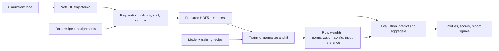

# Experiment pipeline

## Purpose

The pipeline turns simulation trajectories into a reusable dataset, a fitted
model, and an evaluation. Preparation fixes the samples and targets once. Model
iterations share that artifact and write separate run directories. Evaluation
uses the saved samples, so changes to raw simulation directories cannot change
an existing experiment's inputs.

The implementation lives in [stage commands](../ml/src/ml/cmd/pipeline.py),
[preparation](../ml/src/ml/usecases/preprocess.py),
[training](../ml/src/ml/cmd/train.py), and
[evaluation](../ml/src/ml/usecases/evaluate.py).
The [sample contract](pre-processing.md), [grid](grids.md), and [norms](norms.md)
define the scientific calculations.

## Stages and artifacts



| Conventional stage | Reads | Writes | Rerun rule |
|---|---|---|---|
| Simulation | Namelist, Isca code, forcing, replica index | NetCDF segments, namelist, code provenance | Use the simulation's existing segment resume behavior |
| Preparation | Raw segments, data recipe, split assignments, optional sweep metadata | One completed prepared directory | Choose a fresh directory when samples or splits change |
| Training | Completed prepared directory, model and training recipe | One run directory | Choose a fresh run; reuse prepared data |
| Evaluation | Run checkpoint and its exact prepared artifact | Profiles, scores, report, figures under that run | Recompute evaluation without preparing or fitting again |

### 1. Simulation output

NetCDF segments contain fields with dimensions `(time, lat, lon)`. Coordinates
carry units; time carries a CF reference epoch and calendar. Examples are
relative vorticity `vor` in `1/s` and wind `ucomp` in `m/s`. Latitude is a full
Gaussian grid. Longitude is uniform over one period without a duplicate endpoint.
Segments must form one chronological, uniformly sampled trajectory.

`simulations/<configuration-code>-<replica>/` identifies one trajectory.
`sweep.json` is JSON mapping configuration codes to parameter objects, for example
`{"021787": {"stirring_lat0": 30.0}}`. All replicas of one configuration stay in
one split. [Simulation operation](../sim/README.md) describes compilation and runs.

### 2. Preparation recipe and assignments

`prepare.toml` is TOML with `[data]`, `[paths]`, and optional `[logging]`.
`[data]` declares source patterns, input and target variables, windows, optional
detectors, target averaging, and split policy. `[paths]` selects the raw
`experiment_dir`, `preprocessed_dir`, and `splits_dir`. Preparation does not parse
or require model or training settings.

A split JSON contains `train`, `validation`, and `test` arrays of simulation paths
relative to the JSON's directory. `meta` records description, timestamp, and split
policy. Assignments must be disjoint, including configuration replicas. Supplying
`--split` preserves an explicit fixed subset; otherwise preparation generates
assignments using the configured policy. Ratio assignment sorts configuration
codes deterministically. It does not randomize individual windows.

### 3. Prepared dataset

Preparation builds a temporary sibling directory and publishes it by rename only
after all splits and the manifest are complete. Existing output directories are
rejected. Failed staging directories are removed; source data remain untouched.

Let `N` count windows in a split, `S` accepted simulations, `K` snapshots per
window, `V` input variables, `C` target channels, `H` latitudes, and `W` longitudes.
Each of `train.h5`, `val.h5`, and `test.h5` has this HDF5 schema:

| Dataset or attribute | Type / shape | Meaning |
|---|---|---|
| `x` | float32 `(N, K*V, H, W)` | Physical inputs; channels ordered by time, then variable |
| `y` | float32 `(N, C, H)` | Finite-run time-mean zonal-mean profiles, repeated per window |
| `simulation_targets` | float32 `(S, C, H)` | One profile per accepted simulation; supports equal simulation weighting |
| `simulation_paths` | UTF-8 `(S,)` | Stable source identities; downstream stages do not open these paths |
| `simulation_offsets` | int64 `(S+1,)` | Simulation `i` owns rows `[offsets[i], offsets[i+1])`; starts at zero, ends at `N` |
| `window_starts` | int64 `(N,)` | Zero-based snapshot indices in the original trajectory |
| `simulation_provenance` | JSON attribute, `S` objects | Detected spinup/convergence indices, target interval `[a,b)`, timeline length |
| `metadata` | JSON attribute | Versioned coordinates, variable order, input units, window settings, detectors, target rules |
| `exclusions` | JSON attribute | Rejected source identities and reasons |
| `simulations_requested`, `simulations_loaded` | integer attributes | Coverage counts |

An empty validation or test split retains zero-length arrays and the common
metadata. Training must contain usable windows. Nonfinite fields, inconsistent
units, grids, cadence, or unsuccessful required detectors exclude a simulation.
The existing acceptance rules remain the same for small and full runs.

The directory also contains:

| File | Format and important fields |
|---|---|
| `splits.json` | Requested assignments, including sources later excluded |
| `preparation.toml` | Standalone data configuration snapshot with resolved absolute paths |
| `sweep.json` | Optional parameter snapshot for nearest-configuration baselines and plots |
| `manifest.json` | JSON `format="climatology-prepared-v1"`, `files={filename: SHA256}` for all artifact inputs |

The manifest hashes the full file bytes, including saved arrays and source
membership. Training and evaluation verify them. Editing a prepared file requires
a new prepared artifact. Verification reads the files once per stage and costs
I/O proportional to artifact size.

### 4. Training recipe and run

`run.toml` can reference a preparation recipe through the top-level
`data_config="prepare.toml"`; this reference resolves beside the run recipe.
It supplies `[model]`, `[training]`, optional `[logging]`, and
`[paths.training_dir]`. A combined standalone configuration remains supported.
Paths inside `[paths]` resolve against the invocation's working directory, so
commands and wrappers run from the repository root. Saved snapshots use absolute
paths. Referenced preparation recipes cannot chain other references.

| Run artifact | Format and important fields |
|---|---|
| `config.toml` | Standalone effective configuration; includes model architecture, channels, modes, training seed and settings, and data contract |
| `prepared.json` | JSON `directory` and complete `manifest`; binds this run to exact prepared bytes |
| `splits.json` | Training assignment snapshot with paths relative to this file |
| `parameters.pt` | PyTorch state dictionary; best validation checkpoint, or latest epoch when no validation split exists |
| `normalization.pt` | Versioned PyTorch dictionary; `x_mean`, `x_std` shaped `(1,K*V,1,1)`, `y_mean`, `y_std` shaped `(1,C,1)`; epsilon values and versioned metadata |
| `training.json` | JSON run ID, start/end times, epochs, best validation result, data/model/training settings, environment and Git revision |
| `epoch-metrics.csv` | With metrics tracking: run ID, epoch, timestamp, duration, learning rate, train/validation objective |
| `metrics.h5` | With metrics tracking: per-target diagnostics across epochs |

Normalization fits only training windows. Baseline targets retain one row per
training simulation. Model construction gets coordinates from prepared metadata.
The training command rejects an existing run directory instead of moving an old
run. A failed run remains inspectable; retry with a new directory.

Keep the full run and its prepared artifact. Raw trajectories are needed to
change the sample recipe, but not to load the checkpoint or reproduce evaluation.
Training provenance records the current Git revision and whether the checkout
has tracked edits. Use a committed checkout and retain the repository lockfile
for an archived scientific experiment. A training seed controls initialization
and loading order; identical results across devices are not guaranteed.

### 5. Evaluation outputs

Evaluation checks the saved prepared manifest, loads one simulation's windows at
a time, predicts in batches, and averages its window predictions. It then scores
simulations equally in physical units. It uses the saved sweep metadata for
baselines, never the current raw experiment directory.

| File | Format and important fields |
|---|---|
| `evaluation/profiles.npz` | NumPy archive: `simulation_paths (S,)`, `target_names (C,)`, `latitudes (H,)`, `truth` and `predictions (S,C,H)` |
| `evaluation/scores.json` | JSON `targets` keyed by target name: units, aggregation, predictor scores, replica variability, nearest matches; also exclusions and generated figure paths |
| `evaluation/inputs.json` | JSON prepared reference, parameter/normalization/configuration SHA256 values, execution device and batch size |
| `evaluation/report.md` | Markdown numerical tables, coverage, exclusions, and links to figures generated by that invocation |
| `evaluation/figures/` | PNG diagnostics; physical target units and saved coordinates |

A score summary has `mean`, `count`, and `undefined`. A missing baseline records
its reason. Relative errors with a zero reference norm are undefined and counted;
RMSE remains available. The separate prepared-window evaluation API scores
windows individually, so it answers a different aggregation question.

## Command reference

Run from the repository root after `uv sync --project ml --all-groups`.
`bash scripts/pipeline.sh` is a thin wrapper for
`uv run --project ml --all-groups ml pipeline`.

| Stage | Reference command |
|---|---|
| Generate a bounded recipe | `bash scripts/pipeline.sh example --directory output/pipeline-smoke` |
| Prepare the fixed assignments | `bash scripts/pipeline.sh prepare -c output/pipeline-smoke/prepare.toml --split output/pipeline-smoke/splits/fixed.json` |
| Train then evaluate | `bash scripts/pipeline.sh run -c output/pipeline-smoke/run.toml --device cpu` |
| Change only model width; reuse data | `bash scripts/pipeline.sh run -c output/pipeline-smoke/run-wide.toml --device cpu` |
| Train alone | `uv run --project ml --all-groups ml train -c output/pipeline-smoke/run.toml --device cpu --track-metrics` |
| Evaluate alone | `uv run --project ml --all-groups ml evaluate model --training-dir output/pipeline-smoke/run --device cpu --n-workers 0` |
| Evaluate after relocating prepared data | Add `--prepared-dir PATH` to the evaluation command; saved checksums must still match |

`pipeline run` trains and evaluates. It does not prepare again. If training fails,
evaluation does not run. `--workers` controls preparation processes or training
DataLoader workers. Prepared evaluation is serial over simulations and batches
predictions; the legacy `--n-workers` evaluation option remains accepted for
caller compatibility and does not start raw-data workers.

### Small experiments

The synthetic example writes three short labelled Gaussian-grid NetCDF
trajectories using seed 17, then uses the normal pipeline. It tests software
behavior and is not a physical simulation or an estimate of model quality.

For a fixed real subset, use a separate destination:

```bash
bash scripts/pipeline.sh example --directory output/pipeline-real \
    --real-root output/barotropic_stirring-T85
bash scripts/pipeline.sh prepare -c output/pipeline-real/prepare.toml \
    --split output/pipeline-real/splits/fixed.json
bash scripts/pipeline.sh run -c output/pipeline-real/run.toml --device cpu
bash scripts/pipeline.sh run -c output/pipeline-real/run-wide.toml --device cpu
```

The selected trajectories are `10bb40-0` (train), `0f0ad6-0` (validation), and
`021787-0` (test). The real recipe preserves the default detectors, target rules,
and window length, caps windows at two per trajectory, and uses a one-layer,
four-channel SFNO for two epochs. It records these identities in `recipe.json`.
These deliberately small splits measure workflow behavior, not generalization.
The [implementation results](../action-items/03-pipeline-results.md) record
measured time, memory, and verification limits.

### Slurm

Submit from the repository root. Preparation and model execution use the same
wrapper as local runs:

```bash
mkdir -p slurm/output
sbatch slurm/pipeline.slurm prepare -c output/pipeline-real/prepare.toml \
    --split output/pipeline-real/splits/fixed.json
# Alternatively, construct both jobs in a fresh experiment:
bash scripts/submit-pipeline.sh output/pipeline-real/prepare.toml \
    output/pipeline-real/run.toml output/pipeline-real/splits/fixed.json
```

The two-job helper sets `afterok:<preparation-job-id>` on the model job. Failed
submission stops the helper. Failed preparation prevents the dependent job from
running. The run command stops before evaluation if training fails. Shell wrappers
preserve the child process's exit status. The supplied Slurm resources suit small
CPU checks; full runs need explicit resource choices. A cluster needs the same
checkout, locked environment, and shared artifact paths. Historical sweep and
individual-stage Slurm scripts remain separate legacy entry points.

## Decisions and limits

The original flow was traced through `lat0-extra-hi-hold-out.toml`:
preparation wrote arrays, training read them, and evaluation reopened assigned raw
simulations and the current `sweep.json`. Saving window ownership and sweep
metadata closes that second raw-data dependency without replacing the scientific
sample construction or report calculations.

Prepared artifacts are referenced rather than copied into each run. This avoids
large duplicate datasets but means they must be retained. Runs can move within
the same source-path layout; evaluation uses the run directory passed explicitly.
Relocated prepared artifacts require `--prepared-dir` and byte-identical contents.
Moving source identities across filesystems does not rewrite their saved paths.
No automatic stage cache, checkpoint resume, distributed training, or experiment
database is introduced. Old artifacts without the pipeline manifest need fresh
preparation and training; saved originals are preserved.
