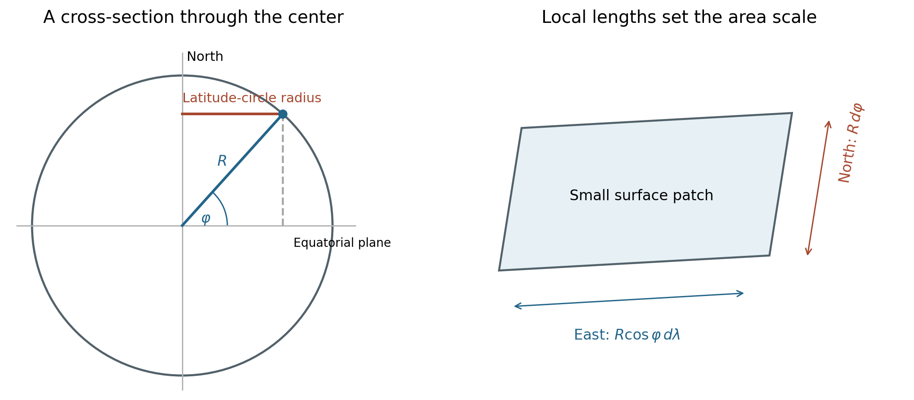
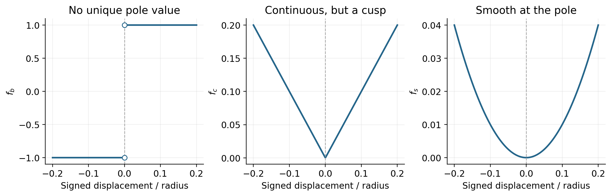

# Table of Contents

1. **[Fields, Operators, and Geometry on a Sphere](#chapter-1).** A physical field as a function; an operator as a map between fields; geometry and its integration measure; inner products, projection, and finite expansions; the connection between a continuous description and its sampled implementation.
2. **[Fourier Analysis Around a Latitude Circle](#chapter-2).** Repeating waves; amplitude and position; complex numbers as two-component bookkeeping; orthogonality, projection, and Fourier coefficients; discrete transforms, sampling limits, and inverse reconstruction.
3. **[Latitude Patterns and Associated Legendre Polynomials](#chapter-3).** Why latitude is not periodic; polynomials and weighted orthogonality; Legendre polynomials, Gaussian quadrature, pole behavior, and the latitude functions associated with each longitude wave.
4. **[Spherical Harmonics and Their Transforms](#chapter-4).** Whole-sphere patterns; degree and order; normalization and real-field symmetry; spherical harmonic analysis and synthesis; truncation, array layout, and contamination from unresolved products.
5. **[The Mathematics of Horizontal Fluid Motion](#chapter-5).** Velocity and circulation; spatial and temporal derivatives; divergence, vorticity, and streamfunction; the spherical gradient and Laplacian; recovering velocity from a scalar description of spin.
6. **[The Barotropic Vorticity Equation](#chapter-6).** The physical assumptions of a horizontal model; planetary rotation; transport of absolute vorticity; forcing and dissipation; conservation statements and their limits; the simulation's numerical update.
7. **[Stochastic Stirring](#chapter-7).** Random variables, means, variance, and correlation; forcing strength and memory; selected spatial scales and geographic localization; seeds, repeated simulations, and the statistics of sustained motion.
8. **[Neural Operators and the FNO](#chapter-8).** Functions, samples, and learned maps; channels and learned parameters; local and global computations; the Fourier Neural Operator (FNO); nonlinearities, finite retained spectra, and resolution dependence.
9. **[The SFNO in This Repository](#chapter-9).** The Spherical Fourier Neural Operator (SFNO); spherical transforms and learned spectral weights; coordinate features, latitude order, and grid contracts; field, profile, and Legendre output heads; properties the architecture does and does not enforce.
10. **[Constructing the Learning Problem](#chapter-10).** Simulation records and units; initial adjustment and empirical convergence checks; input windows and finite-time average targets; configuration-level data splits; normalization, metadata, and information leakage.
11. **[Training and Objectives](#chapter-11).** A complete prediction and parameter-update cycle; squared error and relative norms; area weighting; batches, validation, stopping, and checkpoints; normalized objectives versus physical-unit errors.
12. **[Evaluation and the Complete Project](#chapter-12).** Model loading and reconstruction of the data contract; physical-unit predictions; reference predictors; window and simulation aggregation; variation between repeated runs; diagnosing what the model learned and what the evidence cannot establish.

13. **[The Repository's Implementation](#chapter-13).** [Simulations and preprocessing](#implementation-simulations), [training](#implementation-training), and [evaluation](#implementation-evaluation): the implemented equations, transformations, averaging axes, and evidence limits.

**Written now:** Chapters 1 and 13. Chapters 2-12 link to their roadmap entries below; they are not completed chapters. [Sources and reading route](#references).

\newpage

# Chapter 1: Fields, Operators, and Geometry on a Sphere {#chapter-1}

## The Problem

The project starts with moving fluid on a sphere and ends with a learned prediction of a latitude-dependent average. Between those endpoints, the same physical information appears as a field, a rectangular array, a collection of spatial-pattern coefficients, and a model input. Understanding the project requires a precise account of what each description retains and what each mathematical operation means.

A **field** assigns a physical quantity to each location. Temperature is a **scalar** quantity: one number and its unit specify its value. A scalar field therefore assigns one such number to each location. Wind is a **vector** quantity because its direction matters as well as its magnitude. Its components are numbers measured along stated directions. A **unit** specifies what a number measures, such as meters, seconds, or kelvin. A number without a physical unit is **dimensionless**.

A **function** is a rule that assigns one output to every allowed input. A field can be represented as a function of position. A **sample** evaluates that function at one location; a **grid** specifies several such locations; an **array** stores the resulting numbers in an indexing order. The field and its array are related, but they are different mathematical objects.

An **operator** takes an entire function as input and returns another function. Averaging a global map around each latitude circle is an operator: its input is a field on the sphere, and its output is a profile with one value at each latitude. Predicting a later atmospheric state is another kind of operator. Learning a map between such functions is the central problem formulation of the neural-operator papers. [L21, Sec. 2, PDF p. 3](../../papers/fno.pdf#page=3); [K24, Secs. 2.2-2.3, PDF pp. 7-8](../../papers/no.pdf#page=7).

The operator viewpoint gives this chapter its organizing question: **what mathematical object is transformed, and what geometric information must survive the transformation?** The sequence follows FNO's operator formulation and SFNO's progression from the physical domain to its spherical representation. Vallis supplies the physical coordinate and flow conventions; Arfken and Weber supply the mathematical details needed to read those formulations. [D26, Secs. 2.1.1-2.1.2, PDF pp. 9-10](../../papers/fno-explained.pdf#page=9); [AW05, Secs. 2.1 and 2.5, printed pp. 103-106 and 123-126](../../papers/methods-of-mathemacial-for-physicists.pdf#page=116); [B23, App. A, PDF p. 13](../../papers/sfno.pdf#page=13).

For the geometry, imagine receiving an array with 128 latitude rows and 256 longitude columns. A rectangular storage layout does not make the surface flat. East-west circles shrink toward the poles, longitude wraps around a seam, and every longitude label at a pole identifies the same point. Treating both axes as ordinary repeating image directions imposes the wrong connections on the sphere. This is the geometric motivation for replacing a planar Fourier representation by a spherical one. [B23, Introduction and Secs. 3.3-3.4, PDF pp. 1-4](../../papers/sfno.pdf#page=1).

The fluid model supplies a second reason to care about the representation. Its state can be described using local fluid spin, called **vorticity**, and its numerical method repeatedly changes between a sampled map and spatial-pattern coefficients. Gaussian latitude weights enter those changes of representation. They are part of the mathematical operation, not optional plotting corrections. [BAR, Sec. 3, PDF pp. 4-7](../../papers/barotropic.pdf#page=4). The physical formulation follows [V06, Secs. 4.1 and 12.1.3, printed pp. 163-164 and 495-496](../../papers/atmospheric-and-oceanic-fluid-dymamics.pdf#page=523); the specific stirring model is documented in [V04, Secs. 2-3, PDF pp. 2-6](../../papers/vallis-etal-2024.pdf#page=2).

This chapter establishes the prerequisites: how a field differs from its samples, how the sphere determines lengths and areas, how to compare and project whole fields, and how a finite grid approximates those operations. The numerical examples are worked examples for this textbook. They are not experimental results reproduced from the cited papers.

**Reading the references.** Keys such as AW05 and B23 identify entries in the [source guide](#references). Inline references name the relevant section or equation, and PDF links open at a one-based file page. B23 is Bonev and colleagues' original SFNO paper, and L21 is the original FNO paper. V06 is Vallis's *Atmospheric and Oceanic Fluid Dynamics* (2006), the primary source for physical formulations. AW05 is Arfken and Weber's *Mathematical Methods for Physicists*, sixth edition (2005), used for supporting mathematics. The source guide records the other authors, versions, and a reading route for the planned chapters. The text defines its prerequisites here; reading a cited work is not required before continuing.

## The Intuition

### 1.1 A map, a measurement, and an operation

Imagine a painted globe whose color gives temperature. The paint is the field. A list of thermometer readings is a sampled representation of it. Rotating the globe changes which readings are associated with a fixed external direction; changing the longitude reference merely changes the addresses used to describe the same painted object.

Now imagine walking around each east-west circle and averaging its color values. The result is a new object: a north-south profile. The averaging rule acts on the whole original map, so it is an operator. It can be applied to many different maps without changing its definition. A neural operator aims to learn a rule of this kind from examples, although the useful rule may be far more complicated than averaging. [D26, Sec. 2.1.1, PDF p. 9](../../papers/fno-explained.pdf#page=9).

The project does not learn exactly the weather-forecasting task in the SFNO paper. That paper studies successive atmospheric states. Here the prepared target is an average over a configured time interval and around longitude. The architectural mathematics is relevant to both tasks, but the meanings of the inputs and outputs must be stated separately. [B23, Sec. 3.1, Eq. (1), PDF p. 3](../../papers/sfno.pdf#page=3); [the repository's target contract](../../docs/pre-processing.md).

### 1.2 Components depend on the geometry used to measure them

A displacement can be described by its eastward and northward components. A more complicated field can likewise be described by its components along chosen spatial patterns. The patterns play the role of coordinate directions for the function. Measuring a component requires a rule for comparing the field with a pattern, just as a vector component requires a scalar product. This vector-to-function analogy connects Arfken and Weber's treatment of orthogonal expansions to the representations used by neural operators. [AW05, Secs. 10.3-10.4, printed pp. 642-650](../../papers/methods-of-mathemacial-for-physicists.pdf#page=655); [D26, Sec. 2.1.2, PDF p. 10](../../papers/fno-explained.pdf#page=10).

On a sphere, that comparison must account for physical area. Two equal angular rectangles near the equator and a pole cover different areas. Giving them equal influence measures the storage arrangement rather than the surface. The same area rule that produces a correct average also determines the orthogonality and normalization of the spatial patterns. [AW05, Sec. 2.5, Eqs. (2.39)-(2.42), printed p. 124](../../papers/methods-of-mathemacial-for-physicists.pdf#page=137); [B23, App. A.2, Eqs. (15)-(17), PDF p. 13](../../papers/sfno.pdf#page=13).

### 1.3 Local flatness does not make the global surface a plane

A ruler placed against a smooth globe lies in a plane that touches the surface. This **tangent plane** approximates a small neighborhood. It contains local east and north directions, with an outward direction perpendicular to both. Those directions rotate as the location changes.

A fixed longitude increment spans less physical distance near a pole because the latitude circle is smaller. A change in a field divided by an angular increment is therefore not yet its change per meter. Geometry provides the missing conversion factors. Arfken and Weber introduce these as coordinate scale factors before constructing differential operators. [AW05, Secs. 2.1-2.2, printed pp. 103-113](../../papers/methods-of-mathemacial-for-physicists.pdf#page=116).

Longitude returns to its starting point after a full turn. Latitude instead reaches a pole, where all longitude labels meet. Joining the northern array edge directly to the southern one would make a connection absent from the physical sphere. A representation suitable for longitude alone cannot be copied unchanged to the latitude direction.

### 1.4 A transform cannot restore missing observations

Four thermometers around a circle can all read zero while a smooth temperature pattern rises and falls between them. Those samples cannot distinguish that pattern from the zero field. This is **aliasing**: different continuous patterns produce indistinguishable sampled data.

The remedy is to state which patterns are permitted and choose enough samples to identify them. The barotropic notes make this distinction when separating a retained harmonic representation from the grid used to evaluate it. The neural-operator framework makes a related distinction between a continuum operator and its discrete implementation. [BAR, Sec. 3, PDF pp. 5-7](../../papers/barotropic.pdf#page=5); [K24, Sec. 2.3, PDF p. 8](../../papers/no.pdf#page=8).

The remainder of the chapter develops these relationships in order: functions and operators, the geometry that defines physical measurement, projection onto patterns, and numerical approximation of the resulting integrals. This preserves the dependency order needed to read the research papers without importing their unexplained notation.

## The Mechanism

### 1.5 The continuous learning problem

A **domain** is the collection of positions at which a function is defined. A scalar field's input is a position, and its output is a number. A collection of functions with specified properties is a **function space**. For example, we may consider continuous scalar fields on a sphere, or continuous profiles over the latitude interval. The name describes the permitted objects; it does not turn functions into a finite array.

An operator maps an input function to an output function. Its input and output domains may differ. Longitude averaging maps a two-dimensional field to a one-dimensional profile. A time-evolution operator instead maps a state field to a later state field. This distinction follows the operator-learning formulation rather than the shape of an implementation's tensors. [L21, Sec. 2, Eq. (1), PDF p. 3](../../papers/fno.pdf#page=3); [B23, Sec. 3.1, Eq. (1), PDF p. 3](../../papers/sfno.pdf#page=3); [K24, Sec. 2.2, PDF p. 7](../../papers/no.pdf#page=7).

A **state** is the information used to describe a physical system at one time. For a fluid it can include several fields. In the field viewpoint, a measurement is associated with a fixed position while different fluid parcels pass through that position. A **fluid parcel** means a small identifiable portion of the fluid. Following the parcel gives a different viewpoint; the two descriptions must be related when writing the equations of motion. This is the starting distinction in Vallis's treatment of fluid time derivatives. We will develop their mathematical relationship in the fluid chapter. [V06, Sec. 1.1.1, printed pp. 3-4](../../papers/atmospheric-and-oceanic-fluid-dymamics.pdf#page=31).

Learning an operator means adjusting a computation using many examples of input functions and corresponding output functions. It is different from finding the values of one particular solution. The same learned rule is intended to apply to further admissible inputs. The original FNO paper defines this as approximation of a map between function spaces. Its neural architecture is developed only after the desired map has been identified. [L21, Secs. 2-3, PDF pp. 3-4](../../papers/fno.pdf#page=3).

A deterministic operator returns one output for a specified complete input. A recorded short history need not determine one exact future realization when random forcing or unobserved variables remain. The project fits a deterministic predictor of its saved finite-time target profiles; this does not establish that the input window uniquely determines a stochastic trajectory. This is a distinction between a statistical prediction task and a complete physical evolution law. The SFNO paper explicitly introduces a deterministic-state-map assumption, while the stochastic-jet paper motivates a probabilistic evolution model when information is omitted. [B23, Sec. 3.1, PDF p. 3](../../papers/sfno.pdf#page=3); [S24, Sec. 1, PDF pp. 3-4](../../papers/slt-zonal.pdf#page=3). The actual saved targets are specified by [the repository's sample contract](../../docs/pre-processing.md).

The calculations below begin with an exactly defined operator, longitude averaging, before addressing learned approximations. This lets us separate errors caused by the mathematical model, its finite representation, numerical integration, and learning. Only the last of these requires a neural network.


### 1.6 Coordinates adapted to the physical domain

We approximate Earth by a smooth sphere of constant radius, denoted by $R$. A **radius** is the distance from the center to the surface. This model ignores topography and Earth's small departure from a sphere. Those assumptions match the spherical surface used by this project. Its flow model has no resolved vertical structure and is called barotropic in this context. Vallis uses such a forced model to demonstrate the formation of a latitude-dependent mean wind; we will return to that physical formulation after developing vorticity. [V06, Sec. 12.1.3, Eq. (12.37) and Fig. 12.7, printed pp. 495-496](../../papers/atmospheric-and-oceanic-fluid-dymamics.pdf#page=523). They are not a statement that Earth's real surface is exactly spherical.

Choose three fixed perpendicular axes through the center. Call the coordinates along them $x$, $y$, and $z$. Choose the positive $z$ axis to point toward the North Pole. Choose the positive $x$ axis to meet the equator at the reference longitude. The positive $y$ axis then meets the equator 90 degrees east of that reference. Coordinates measured along fixed perpendicular axes are called **Cartesian coordinates**.

**Latitude**, denoted by $\varphi$, is the angle north or south of the equatorial plane. It ranges from minus 90 degrees to plus 90 degrees. **Longitude**, denoted by $\lambda$, is the angle around the rotation axis measured eastward from the reference line. We usually store it from zero up to, but excluding, 360 degrees.

A **radian** measures angle by the length traveled around a circle divided by the circle's radius. The constant $\pi$ is a circle's circumference divided by its diameter, approximately 3.14159. One complete turn is 360 degrees or twice $\pi$ radians. The trigonometric and calculus formulas in this chapter take radian arguments.

The **cosine** and **sine** of an angle describe the horizontal and vertical coordinates, respectively, of a point one unit from the origin on a plane circle. For latitude, cosine gives the radius of the latitude circle as a fraction of $R$; sine gives height above the equatorial plane as a fraction of $R$. For longitude, they split the latitude circle's radius into its fixed $x$ and $y$ components.

Some references measure the north-south angle downward from the North Pole. That angle is **colatitude**, denoted by $\theta$. Latitude and colatitude describe the same location with different zero points and opposite directions of increase. Mixing their conventions changes signs and exchanges sine with cosine. We will state which convention every formula uses.

The physical-coordinate convention follows Vallis's use of longitude and latitude. Arfken and Weber and the SFNO appendix instead use colatitude and longitude. We translate their formulas into one fixed convention rather than silently changing the meaning of a symbol between sources. [V06, Sec. 2.2.2, printed pp. 57-58](../../papers/atmospheric-and-oceanic-fluid-dymamics.pdf#page=85); [B23, App. A.1](../../papers/sfno.pdf#page=13); [AW05, Sec. 2.5](../../papers/methods-of-mathemacial-for-physicists.pdf#page=136).

### 1.7 Single-valued fields and coordinate identifications

At an ordinary location away from the poles and the chosen longitude seam, a pair of latitude and longitude values identifies one point uniquely. Around the seam, two longitude labels separated by a full turn identify the same point. At either pole, an entire circle of longitude labels identifies one point.

A coordinate description that is locally unambiguous is called a **chart**. Latitude and longitude provide a useful chart away from the poles, but they cannot provide one globally unambiguous rectangular address system for the whole sphere. The poles are **coordinate singularities**: the address system loses its ability to distinguish directions there. The physical surface remains smooth.

A **continuous field** has no jumps between physically nearby points. More precisely, requesting a sufficiently small change in its value must be achievable by restricting attention to a sufficiently small physical neighborhood. This definition uses distance on the surface, not the numerical difference between coordinate labels. Longitudes just below 360 degrees and just above zero describe nearby points.

Continuity requires matching values across the longitude seam and a unique limiting value at each pole. Smoothness demands more. A **differentiable field** has a consistent local linear rate of change: close to a point, its variation is approximated by a slope in each tangent direction. A **smooth field** has continuous derivatives of all orders. This stronger property is useful because repeated differentiation occurs in the fluid equations and in spectral analysis.

A field can be continuous at a pole and still have a cusp there. A pattern's **amplitude** is the scale of its variation. Making its longitude-dependent amplitude shrink to zero is necessary for continuity, but it does not by itself establish differentiability. The pole-regularity example under Reading the Math makes this distinction explicit.

### 1.8 Local directions, physical rates, and distance

A vector can be stored as an ordered list of components along specified axes. The **dot product** of two real vectors multiplies corresponding components and adds the results. It measures alignment as well as size. The dot product of a vector with itself is its squared length. Taking the nonnegative square root gives its length, also called its **norm**.

A **unit vector** has length one and indicates direction without setting a physical magnitude. **Orthogonal** vectors have zero dot product; geometrically, they are perpendicular. An **orthonormal** collection consists of mutually perpendicular unit vectors.

At a nonpolar point, local east, local north, and the outward radial direction form an orthonormal collection. We denote them by $\mathbf e_{\mathrm E}$, $\mathbf e_{\mathrm N}$, and $\mathbf e_{\mathrm R}$. Bold type identifies a vector. Subscripts $\mathrm E$, $\mathrm N$, and $\mathrm R$ label directions; they are not numbers or quantities to multiply.

A velocity component of ten meters per second eastward refers to the local east vector at the location where the wind is measured. Reusing the same component at another location does not mean reusing the same fixed three-dimensional direction. This is one reason vector fields need additional care beyond scalar fields.

A finite change, written with $\Delta$, compares two separated values. An **infinitesimal displacement**, written with $d$, describes the leading behavior as that separation becomes arbitrarily small. It is a tool for local geometry, not a claim that a computer stores infinitely small numbers.

A **derivative** measures the limiting ratio of a change in output to a change in input. A **partial derivative** varies one input while holding the others fixed. We write $\partial$ in a partial derivative to emphasize this restriction. A **limit** records the value approached as an increment is made arbitrarily small, when that value exists.

The **gradient** of a scalar field is a tangent vector pointing in the direction of fastest local increase. Its length is the increase per unit physical distance in that direction. A temperature gradient therefore has units of temperature per meter. An angular partial derivative has units of temperature per radian and must be converted using the local length associated with that angle.

These definitions introduce the operations needed to read the local formulas. They do not require a derivation of multivariable calculus. The local scale-factor construction follows [V06, Sec. 2.2.2, Eqs. (2.27)-(2.31), printed pp. 57-58](../../papers/atmospheric-and-oceanic-fluid-dymamics.pdf#page=85); the general orthogonal-coordinate development is in [AW05, Secs. 2.1-2.2](../../papers/methods-of-mathemacial-for-physicists.pdf#page=116).

A route along a latitude circle is a particular path. It is generally not the shortest surface route between its endpoints. A **great circle** is the intersection of the sphere with a plane passing through its center. The shorter great-circle arc gives the shortest surface distance between distinct nonopposite points. Such a shortest path is called a **geodesic**.

A plane through the equator passes through the center, so the equator is a great circle. A plane through a northern latitude circle generally misses the center, so that circle is smaller. Two points on the same northern latitude can be connected more directly by a path that bows toward the pole.

This distinction matters when interpreting grid spacing. Neighboring points separated by a very small longitude increment have nearly the same coordinate-path and geodesic distances to leading order. For long separations, the difference can be substantial. A local formula should not be extended to an arbitrary global distance without checking its assumptions.

### 1.9 Integration over the physical surface

An **integral** adds contributions from arbitrarily small pieces of a continuous region. For surface area, each piece contributes its area. For a field, each piece contributes its value multiplied by its area. A **surface integral** performs this accumulation over a surface.

An area element, written $dA$, represents the infinitesimal surface patch used in this accumulation. Its expression depends on the coordinate labels. The physical area does not. The factor converting a coordinate rectangle into physical area is sometimes called an **area Jacobian**. Here it accounts for radius and the shrinking of latitude circles.

A **mean**, or average, divides a total accumulated quantity by the size of the region over which it was accumulated. A surface mean of temperature is therefore an area integral of temperature divided by the total area. The sphere's radius cancels from this average when the same angular temperature pattern is considered on spheres of different radii.

A useful alternative coordinate is the signed height fraction, denoted by $\mu$. It is the sine of latitude and ranges from minus one at the South Pole to one at the North Pole. Equal intervals of this height fraction correspond to equal-area complete latitude belts. Equal latitude-angle intervals do not.

Changing from latitude to height fraction is a **change of variables**. It leaves the physical accumulated quantity unchanged while simplifying its coordinate expression. This change of variables explains the particular Gaussian quadrature used in the repository.

The SFNO paper uses angular area on a unit sphere, while a physical area on a radius-$R$ sphere includes squared radius. Its harmonic inner product is an integral rather than an area mean. These conventions differ by constant factors; orthogonality survives, but unit-normalized basis values and coefficient scales can change. We will calculate those factors explicitly before comparing formulas. [B23, App. A.2, Eqs. (15)-(17)](../../papers/sfno.pdf#page=13); [AW05, Sec. 2.5, Eqs. (2.40)-(2.42)](../../papers/methods-of-mathemacial-for-physicists.pdf#page=137).

### 1.10 Inner products and field magnitude

Two ordinary vectors can be compared by a dot product. Two real scalar fields can be compared by multiplying their values at each location and taking an area average. This operation is an **inner product** of fields. It tells us whether their positive and negative patterns tend to align after surface area is taken into account.

The norm associated with this inner product is the square root of the area mean of the squared field. It is a **root mean square**, abbreviated RMS. Squaring prevents positive and negative values from canceling. The RMS of an error field is a global measure of error magnitude.

Two nonzero fields are called **orthogonal** when their inner product is zero. This does not mean their colored regions never overlap. It means their signed product cancels when averaged with the specified weighting. Changing the weighting can change which fields are orthogonal.

A **projection** measures how much of a chosen pattern is present in a field. For one pattern, it selects the multiplying coefficient that minimizes the mean squared residual. A **residual** is what remains after subtracting the chosen approximation. Several mutually orthogonal patterns can be measured without their coefficients interfering with one another. This is the mathematical idea behind the transforms developed in Chapters 2-4.

All fields in the present chapter are real-valued. A real number is an ordinary signed number on the number line. Chapter 2 will extend the bookkeeping to complex numbers and explain the corresponding adjustment to the inner product.

This is the useful part of the vector-space analogy: a scalar product defines which patterns are perpendicular, normalization defines their sizes, and projection measures components. The source papers use more general function-space terminology, but these operations are the prerequisites needed here. [B23, App. A.2](../../papers/sfno.pdf#page=13); [AW05, Secs. 10.3-10.4](../../papers/methods-of-mathemacial-for-physicists.pdf#page=655).

### 1.11 Basis representations and truncation

Sampling is a map from a function to a finite array. Many different functions can map to the same array. A **reconstruction** is a rule that selects a function from those samples, usually by restricting the permitted patterns.

A **basis** is a collection of patterns from which the permitted functions can be constructed uniquely by taking weighted sums. The multiplying numbers are **coefficients**. A **mode** is one such pattern, usually labeled according to its spatial structure. A **spectral representation** stores the coefficients of wave-like modes rather than only local sampled values.

A finite set of retained modes describes a restricted class of fields. Removing modes outside that set is **truncation**. Increasing the number of sample points while leaving the retained set unchanged can improve numerical calculations without expanding the represented physical detail. Increasing the retained set without enough samples can make distinct patterns indistinguishable.

The geometric grid, the retained representation, and the accuracy of a numerical integration rule are therefore separate choices. Their compatibility will become a central concern in the spherical harmonic transform. We begin by putting the continuous geometry and its discrete approximation on a precise footing.

For a finite orthogonal family, projection chooses the approximation with the smallest integrated squared residual among combinations of the retained patterns. Extending the family can reduce that error. **Completeness** means the allowed family can make the mean squared error arbitrarily small by retaining enough patterns. It is a statement about convergence under the selected integral, not an unconditional promise of exact pointwise agreement after a finite truncation. [AW05, Sec. 10.4, Eqs. (10.62)-(10.64), printed pp. 649-650](../../papers/methods-of-mathemacial-for-physicists.pdf#page=662). The SFNO paper uses a spherical harmonic basis for this representation; its construction is reserved for Chapters 3-4. [B23, Sec. 3.4, Eqs. (7)-(8)](../../papers/sfno.pdf#page=4).

### 1.12 Quadrature and discrete spectral analysis

A computer cannot evaluate an arbitrary continuous field at every point. **Quadrature** estimates an integral from finitely many samples and numerical weights. A weight specifies how much a sample contributes to that particular integration rule.

An equiangular grid places rows at equal angular latitude intervals. A Gaussian grid chooses particular latitude locations and accompanying weights. **Gauss-Legendre quadrature** is the rule that integrates polynomials in the height fraction accurately with no additional weighting function on the interval from minus one to one.

A **polynomial** is a finite sum of nonnegative whole-number powers of its input multiplied by coefficients. Its **degree** is the highest power with a nonzero coefficient. Gaussian quadrature with a given number of latitude nodes is exact, apart from arithmetic rounding, for polynomials through degree twice the node count minus one. Exactness for one polynomial does not imply exactness for its square, which can have twice the degree. The [NIST quadrature reference](https://dlmf.nist.gov/3.5#v) states the general rule.

A **node** is a sampling location. The Gaussian nodes and their weights are selected together. The weights are not automatically the areas of cells drawn halfway between the nodes. A finite-volume scheme, which stores averages over physical cells, and a Gaussian quadrature scheme, which weights point samples, are distinct numerical constructions.

The project's **full Gaussian grid** has the same number of equally spaced longitudes on every latitude row. A **reduced Gaussian grid** decreases the number of longitude samples toward the poles. Both use Gaussian latitude placement, but only the first naturally fits the rectangular spatial array supported by this project's ML reader. See the [ECMWF grid descriptions](https://confluence.ecmwf.int/spaces/FCST/pages/49415103/Gaussian%2Bgrids).

For the discrete spherical transform, the SFNO implementation combines a longitude transform with a weighted latitude sum. Its latitude weights depend on the spatial grid. The inverse rebuilds values by a sum over retained patterns; that synthesis sum is not another latitude integral and does not receive another copy of the integration weights. We will follow the full array calculation in Chapter 4. [B23, App. B.1, Eqs. (24)-(29), PDF p. 15](../../papers/sfno.pdf#page=15).

### 1.13 Discretization and the limits of a grid-independent description

A **discretization** replaces a continuous description by finitely many stored quantities. Point sampling is one discretization; retained pattern coefficients are another. A **reconstruction** assigns a function to the finite representation according to a specified rule. Neither operation is defined by array shape alone.

The operator papers distinguish a continuum rule from numerical evaluations of it. **Refinement** means using increasingly informative discretizations. A discretization-consistent implementation approaches the same continuum operation as the numerical representation is refined under the required assumptions. Reusing one learned parameter set across resolutions is therefore compatible with nonzero, resolution-dependent numerical error. [K24, Sec. 2.3, PDF pp. 8-9](../../papers/no.pdf#page=8); [L21, Sec. 4, PDF p. 5](../../papers/fno.pdf#page=5).

There are two different reconstruction questions. Starting with a field in a retained spectral family, sufficient samples can preserve all of its coefficients. Starting with an arbitrary array, projecting onto that family can remove components that lie outside it. The barotropic notes explicitly distinguish these two round trips. Their transform grid can have more entries than the retained harmonic family can represent independently. [BAR, Sec. 3, PDF pp. 6-7](../../papers/barotropic.pdf#page=6).

Calling an architecture grid-independent does not mean that any input coordinates are valid for any transform implementation. The appropriate grid, integration weights, finite retained patterns, and physical units must still agree. The repository currently checks a particular full Gaussian grid. This is an implementation contract, not a contradiction of the continuum formulation.

The next sections give explicit geometry, integrals, projections, and a smooth field invisible to an undersampled grid. Together they explain what the continuous formulation contributes and what its finite implementation must verify.


## Reading the Math

The right-hand labels identify equations for later reference. They are reference numbers, not factors in the calculations. All trigonometric arguments in the equations are in radians unless a degree label explicitly says otherwise.

### 1.14 Functions and operators have different inputs

**Average a painted globe into one stripe per latitude.** A scalar field accepts one location and returns one real number. The zonal-average operator accepts that entire field and returns a profile. Write $\mathcal S_R$ for the sphere with radius $R$, $\mathbb R$ for the real numbers, $\mathcal A$ for the allowed input fields, and $\mathcal U$ for the resulting latitude profiles. The letter $g$ will name the output profile, and $\mathcal Z$ will name the averaging rule already described.

$$
f:\mathcal S_R\longrightarrow\mathbb R,
\qquad \mathcal Z:\mathcal A\longrightarrow\mathcal U,
\qquad g=\mathcal Z[f].
\tag{1.1}
$$

**Symbol-by-Symbol**

- $f$: a scalar field; $\mathcal S_R$: its spherical input domain; subscript $R$: the physical radius. $\mathbb R$: real-valued outputs in the field's stated unit.
- $\mathcal A$: the collection of permitted whole fields; $\mathcal U$: the collection of latitude profiles; $\mathcal Z$: the operator taking a field to its zonal average; $g$: the resulting profile.
- $:$ reads "has input and output types"; $\longrightarrow$ points from allowed inputs to outputs; square brackets enclose an entire function supplied to the operator; $=$ identifies the result.

**Plain-English Translation:** A field converts a location into a measurement, whereas the zonal-average operator converts a whole spherical field into a latitude profile.

A function collection needs stated regularity and size restrictions. For the averages below, the relevant integrals must exist; for the squared-error comparisons, integrals of squared values must be finite. Smooth fields on the finite sphere satisfy these requirements. An operator formulation does not imply that a finite input record determines every possible target without uncertainty. Omitted random forcing and unobserved times can leave several outcomes compatible with the same observed window. [L21, Sec. 2](../../papers/fno.pdf#page=3); [B23, Sec. 3.1](../../papers/sfno.pdf#page=3).

### 1.15 Coordinates, units, and the embedded sphere

**Begin with a marked angle.** A 90-degree turn is one quarter of a full circle. The same angle is half of $\pi$ radians. To keep units visible, let $a_{\mathrm{deg}}$ denote the numerical angle in degrees and $a_{\mathrm{rad}}$ the numerical angle in radians. Colatitude $\theta$ is measured downward from the North Pole, whereas latitude $\varphi$ is measured upward from the equator.

$$
a_{\mathrm{rad}}=\frac{\pi}{180}\,a_{\mathrm{deg}},
\qquad
\theta=\frac{\pi}{2}-\varphi.
\tag{1.2}
$$

**Symbol-by-Symbol**

- $a$: the angle being expressed; subscripts $\mathrm{deg}$ and $\mathrm{rad}$ select its degree and radian numerical values.
- $\pi$: circumference divided by diameter; 180 is the number of degrees in a half-turn, and 2 divides a half-turn into a quarter-turn.
- $\theta$: colatitude in radians. $\varphi$: latitude in radians.
- $=$ means equality; the fraction bars mean division; adjacency means multiplication; $-$ subtracts latitude from a quarter-turn. The comma and spacing separate the two statements.

**Plain-English Translation:** Convert angle units before calculation, and measure north-south position from the correct reference direction.

A degree-to-radian error is not a small rounding error. Passing 60 directly to a cosine function that expects radians means asking for the cosine of an angle larger than nine complete turns. The expected latitude-circle radius fraction is one-half; the mistaken answer is negative. A negative geometric radius is a warning that the interpretation has already failed.

**Now locate the point in three-dimensional space.** Let $\mathbf r$ be the position vector from the sphere's center to a surface point. Its three components are the Cartesian coordinates $x$, $y$, and $z$ defined earlier. The horizontal circle has radius $R\cos\varphi$; longitude divides that horizontal radius between the $x$ and $y$ axes.

$$
\mathbf r(\varphi,\lambda)
=(x,y,z)
=R\bigl(\cos\varphi\cos\lambda,
        \cos\varphi\sin\lambda,
        \sin\varphi\bigr),
\qquad x^2+y^2+z^2=R^2.
\tag{1.3}
$$

**Symbol-by-Symbol**

- $\mathbf r$: a vector, indicated by bold type; the parentheses after it specify the latitude and longitude at which it is evaluated.
- $\varphi$, $\lambda$: latitude and longitude in radians. $R$: sphere radius in length units.
- $x$, $y$, $z$: fixed-axis position components, in the same length units as $R$.
- $\sin$, $\cos$: sine and cosine. A parenthesized three-entry list is an ordered vector of components; commas separate its entries.
- Superscript $2$ means squaring; $+$ adds squared components; $=$ means equality. Multiplication is written by adjacency; multiplying a vector by $R$ multiplies each component by $R$.

**Plain-English Translation:** Latitude and longitude label a point whose distance from the center is always the prescribed sphere radius.

At the equator and reference longitude, the position lies entirely on the positive $x$ axis. At the equator and 90 degrees east, it lies on the positive $y$ axis. At the North Pole, the horizontal components vanish and only the positive $z$ component remains. These three cases are inexpensive checks of any coordinate-conversion function.

The final equality is a geometric constraint. It states that the surface is two-dimensional even though it is described using three Cartesian components. Two coordinates can vary independently; the radius fixes the remaining freedom.

The embedding and coordinate conversion follow [B23, App. A.1](../../papers/sfno.pdf#page=13) and [AW05, Sec. 2.5](../../papers/methods-of-mathemacial-for-physicists.pdf#page=136).

### 1.16 Continuity, periodicity, and pole identifications

**Follow one painted mark across the seam.** A full longitude turn returns to the same location. At a pole, turning around the longitude circle never changes the physical location at all. Let $f$ be a scalar field and let $f_{\mathrm N}$ and $f_{\mathrm S}$ denote its unique north and south pole values. The coordinate function must satisfy:

$$
\begin{aligned}
f(\varphi,\lambda+2\pi)&=f(\varphi,\lambda),\\
f\left(\frac{\pi}{2},\lambda\right)&=f_{\mathrm N},
&f\left(-\frac{\pi}{2},\lambda\right)&=f_{\mathrm S}.
\end{aligned}
\tag{1.4}
$$

**Symbol-by-Symbol**

- $f$: the scalar field; $f(\varphi,\lambda)$ means its value at the stated latitude and longitude.
- $\varphi$, $\lambda$: latitude and longitude. $\pi$: the circle constant; $2\pi$ is one full turn, and $\pi/2$ is a quarter-turn.
- $f_{\mathrm N}$, $f_{\mathrm S}$: single physical pole values; the subscripts label north and south, and neither depends on longitude.
- $+$ adds one full turn; the leading $-$ selects the southern latitude; fractions divide; $=$ requires equal physical values. Parentheses group function inputs; commas separate them.

**Plain-English Translation:** Different coordinate addresses for the same point must return the same scalar value.

These equalities state necessary identifications. Continuity additionally requires that values approaching a pole tend to the pole value regardless of approach direction. Merely filling the final array row with a constant while the preceding rows approach incompatible values does not repair the field.

For a smooth field, the matching across the longitude seam also applies to its derivatives. A map with identical endpoint values but mismatched slopes still contains a physical crease. This matters to spectral representations because differentiation magnifies irregular behavior and makes additional short-scale patterns necessary to describe it.

Avoiding samples exactly at the poles is a useful numerical design choice, but it does not remove the underlying consistency requirement. The function represented by those samples must still be a function on the sphere.

### 1.17 Local length, the metric, and global distance

**Put two perpendicular rulers on the surface.** One lies along a latitude circle and one points north. Their directions in fixed Cartesian coordinates are given by unit vectors $\mathbf e_{\mathrm E}$ and $\mathbf e_{\mathrm N}$; the outward unit vector is $\mathbf e_{\mathrm R}$.

$$
\begin{aligned}
\mathbf e_{\mathrm E}&=(-\sin\lambda,\ \cos\lambda,\ 0),\\
\mathbf e_{\mathrm N}&=(-\sin\varphi\cos\lambda,
                       -\sin\varphi\sin\lambda,
                        \cos\varphi),\\
\mathbf e_{\mathrm R}&=(\cos\varphi\cos\lambda,
                        \cos\varphi\sin\lambda,
                        \sin\varphi).
\end{aligned}
\tag{1.5}
$$

**Symbol-by-Symbol**

- Bold $\mathbf e$ denotes a direction vector; subscripts $\mathrm E$, $\mathrm N$, and $\mathrm R$ select east, north, and radial outward directions.
- $\varphi$, $\lambda$: latitude and longitude; $\sin$ and $\cos$: sine and cosine.
- Each three-entry list gives components along fixed $x$, $y$, and $z$ axes. Zero means no component along that axis.
- Leading $-$ reverses a component; adjacency multiplies; $=$ specifies the vector. Commas separate components.

**Plain-English Translation:** Local east and north rotate through three-dimensional space as the observer moves over the sphere.

For example, at the equator and reference longitude, local east points along positive $y$, local north along positive $z$, and outward along positive $x$. The dot product of each pair is zero and each vector has length one. These checks establish the local orthonormal frame away from the poles. At a pole, the formulas depend on an arbitrary longitude label, revealing the absence of a unique east direction there.

**Convert the two rulers into a distance rule.** Write $ds$ for infinitesimal path length, $d\varphi$ for a small north-south angular displacement, and $d\lambda$ for a small east-west angular displacement. Because the local directions are perpendicular, their squared lengths add:

$$
ds^2=R^2\,d\varphi^2+R^2\cos^2\varphi\,d\lambda^2.
\tag{1.6}
$$

**Symbol-by-Symbol**

- $ds$: infinitesimal physical path length. The $d$ marks a local differential quantity, not multiplication by a separate variable.
- $R$: radius; $d\varphi$, $d\lambda$: infinitesimal latitude and longitude changes in radians.
- $\cos\varphi$: latitude-circle shrinking factor; $\cos^2\varphi$ means the square of that cosine.
- Superscript $2$ squares the indicated length or increment. $+$ adds perpendicular squared lengths; $=$ states the local distance rule; adjacent factors multiply.

**Plain-English Translation:** North-south and east-west angular changes contribute different physical lengths, and their perpendicular contributions combine by the ordinary right-triangle rule.

This rule is the sphere's **metric** in latitude-longitude coordinates: it specifies physical length from coordinate displacement. The metric does not assert that a finite spherical patch is exactly flat. It gives the leading local behavior from which curved-path lengths are accumulated.

For a finite eastward motion that stays at fixed latitude, the corresponding arc length is radius times longitude change, using the latitude-circle radius. At Earth's approximate radius of 6,371 kilometers, one degree along the equator spans about 111.195 kilometers. At 60 degrees north the same angular longitude increment spans about 55.597 kilometers. One degree of northward displacement along a meridian spans about 111.195 kilometers at both locations.

A three-by-three array neighborhood therefore covers different physical shapes at different latitudes. A translation of a pattern by one array column is not generally the same physical displacement everywhere. A flat-image operation can still be useful as a numerical component, but its geometric interpretation must be justified.

{width=95%}

**Now compare widely separated points.** Let $\gamma$ be the central angle between their radial vectors. Let $d_{12}$ be the shorter surface distance between point 1 and point 2. The inverse cosine function, written $\arccos$, returns the angle between zero and $\pi$ whose cosine is the supplied value.

$$
\begin{aligned}
\cos\gamma
&=\frac{\mathbf r_1\cdot\mathbf r_2}{R^2}
=\sin\varphi_1\sin\varphi_2
 +\cos\varphi_1\cos\varphi_2\cos(\lambda_2-\lambda_1),\\
d_{12}&=R\,\arccos(\cos\gamma).
\end{aligned}
\tag{1.7}
$$

**Symbol-by-Symbol**

- $\gamma$: central angle, selected between zero and $\pi$ radians. $d_{12}$: shorter great-circle distance, with the subscript labeling the two points.
- $\mathbf r_1$, $\mathbf r_2$: position vectors of the two surface points. Subscripts 1 and 2 select points throughout the equation.
- $\varphi_1$, $\varphi_2$, $\lambda_1$, $\lambda_2$: their latitudes and longitudes. $R$: common sphere radius.
- $\cdot$: vector dot product, the sum of products of corresponding Cartesian components.
- $\sin$, $\cos$: trigonometric functions; $\arccos$: inverse cosine. Parentheses group the longitude difference or a function's input.
- $R^2$: squared radius; fraction bar: division; $+$ and $-$: addition and subtraction; adjacency: multiplication; $=$: equality.

**Plain-English Translation:** Compare the two outward directions to obtain their angular separation, then convert that angle into the shorter surface distance.

Take two points at 60 degrees north separated by 90 degrees of longitude. Their radial dot product divided by squared radius is 0.75. The shorter great-circle distance is about 4,604.5 kilometers. The route along their latitude circle is about 5,003.8 kilometers. Both are valid lengths, but they describe different routes.

In floating-point arithmetic, which stores numbers to finite precision, a computed normalized dot product can lie slightly outside the interval from minus one to one. Clipping that computed argument to the permitted interval prevents a spurious inverse-cosine failure. For very close points, inverse cosine also loses relative precision because its argument is extremely close to one. Numerical geodesic libraries use more stable equivalent formulations in that regime. Neither issue changes the geometry.

Local directions, scale factors, and surface distances follow [V06, Sec. 2.2.2](../../papers/atmospheric-and-oceanic-fluid-dymamics.pdf#page=85) and [AW05, Sec. 2.5, including Exercise 2.5.6](../../papers/methods-of-mathemacial-for-physicists.pdf#page=136).

### 1.18 Derivatives, physical slopes, and regularity at a pole

**Measure a slope by shortening the ruler.** Suppose we vary longitude while holding latitude fixed. Let $h$ denote the longitude increment in radians. The angular partial derivative records the limiting change per angular increment:

$$
\frac{\partial f}{\partial\lambda}(\varphi,\lambda)
=\lim_{h\to0}
\frac{f(\varphi,\lambda+h)-f(\varphi,\lambda)}{h}.
\tag{1.8}
$$

**Symbol-by-Symbol**

- $f$: scalar field; $\varphi$, $\lambda$: latitude and longitude at the evaluation point.
- $\partial f/\partial\lambda$: partial derivative with respect to longitude while latitude is fixed; $\partial$ marks the one-input variation.
- $h$: angular increment. $\lim_{h\to0}$ means the limiting value as $h$ approaches zero from either sign.
- $f(\varphi,\lambda+h)$: field value at the shifted longitude. Parentheses contain inputs; commas separate them.
- $+$ shifts longitude; $-$ forms the field difference; the fraction divides by the angular increment; $=$ asserts that the limit defines the derivative when the limit exists.

**Plain-English Translation:** Compare nearby values while varying only longitude, and ask what change per angular step remains as the step becomes arbitrarily small.

A computer usually approximates a derivative using a finite increment. Shrinking that increment first reduces the error caused by a finite step, but eventually subtraction of nearly equal stored numbers magnifies rounding error. A valid mathematical limit is therefore not a prescription to choose the smallest representable numerical step.

**Convert an angular slope into a physical gradient.** The northward physical distance per latitude increment is $R$. The eastward distance per longitude increment is $R\cos\varphi$. Divide the corresponding angular slopes by these lengths and attach the correct local directions:

$$
\nabla_{\!S}f
=\mathbf e_{\mathrm N}\frac{1}{R}\frac{\partial f}{\partial\varphi}
 +\mathbf e_{\mathrm E}\frac{1}{R\cos\varphi}
                            \frac{\partial f}{\partial\lambda}.
\tag{1.9}
$$

**Symbol-by-Symbol**

- $\nabla_{\!S}$: surface-gradient operator; $\nabla$ denotes a spatial rate-of-change operation and subscript $S$ restricts it to the spherical surface.
- $f$: scalar field. $\varphi$, $\lambda$: latitude and longitude; $R$: radius; $\cos\varphi$: latitude-circle radius fraction.
- $\mathbf e_{\mathrm N}$, $\mathbf e_{\mathrm E}$: local north and east unit vectors; subscripts label directions.
- $\partial f/\partial\varphi$, $\partial f/\partial\lambda$: angular partial derivatives, holding the other angle fixed.
- Fractions divide slopes by physical length factors; adjacency multiplies vectors by scalar components; $+$ adds the two directional contributions; $=$ specifies the gradient.

**Plain-English Translation:** A physical slope is an angular slope divided by the physical distance represented by that angle, resolved into local north and east components.

Away from the poles, the formula is directly usable. At a pole, the east direction is undefined and its denominator vanishes. For a smooth physical field, this coordinate expression must be interpreted by limits or replaced by a nonsingular coordinate description. A divergent intermediate factor alone does not prove that the physical field has an infinite gradient.

A useful example is the normalized height field. Its value is sine of latitude. Its northward slope is cosine of latitude divided by radius, and its eastward slope is zero. The physical gradient tends to zero at both poles. A formula containing a potentially vanishing denominator can therefore describe a perfectly regular field when its numerator vanishes appropriately.

**Compare three proposed longitude-dependent patterns.** Let $b$ label a bad pole behavior, $c$ label a continuous but nonsmooth behavior, and $s$ label a smooth behavior. These are labels, not multiplying variables. Consider dimensionless fields:

$$
\begin{aligned}
f_b(\varphi,\lambda)&=\cos\lambda,\\
f_c(\varphi,\lambda)&=\cos\varphi\cos(2\lambda),\\
f_s(\varphi,\lambda)&=\cos^2\varphi\cos(2\lambda)
                    =\frac{x^2-y^2}{R^2}.
\end{aligned}
\tag{1.10}
$$

**Symbol-by-Symbol**

- $f_b$, $f_c$, $f_s$: the three fields; their subscripts label the cases just described.
- $\varphi$, $\lambda$: latitude and longitude; $x$, $y$: Cartesian coordinates; $R$: radius.
- $\cos$: cosine; $2\lambda$ means twice the longitude. Superscript $2$ squares its quantity, including the cosine in $\cos^2\varphi$.
- The fraction divides by squared radius, making the field dimensionless. $-$ subtracts squared coordinates; adjacency multiplies; $=$ identifies equal representations of the same field.

**Plain-English Translation:** Longitude variation needs an appropriate latitude-dependent amplitude to fit smoothly together at a pole.

The first field is unacceptable as a continuous scalar field at the pole. Approaching along longitude zero gives one; approaching along longitude 180 degrees gives minus one. The two paths reach the same point with incompatible limiting values.

The second field approaches zero from every direction because its amplitude is bounded by the latitude cosine. It is continuous when assigned zero at a pole. Nevertheless, along a straight local path through the North Pole in the fixed $x$ direction, it behaves like the absolute value of horizontal displacement divided by radius. Its graph has a cusp. The slope on one side of the pole has the opposite sign to the slope on the other, so there is no differentiable local linear description.

The third field is a polynomial in the fixed Cartesian coordinates divided by a constant. That expression stays smooth at the pole. In the same cross-pole direction it behaves quadratically, with a slope tending to zero. This demonstrates why continuity alone is too weak a criterion for fields that will be differentiated repeatedly.

{width=100%}

Spherical harmonics will supply latitude-longitude combinations that satisfy the required pole behavior as complete patterns. The restriction is geometric; it is not an optional cosmetic treatment applied after performing a transform.

The spherical gradient is Vallis's horizontal gradient in our fixed-radius latitude convention. [V06, Eq. (2.31)](../../papers/atmospheric-and-oceanic-fluid-dymamics.pdf#page=86). The pole examples above test this geometry directly.

### 1.19 Surface area and the height-fraction coordinate

**Cover a small patch with the two local rulers.** Its leading north-south length is radius times latitude increment. Its leading east-west length includes the cosine shrinking factor. Their product gives the physical area element.

Write $\mu$ for signed height divided by radius. The relation between height fraction and latitude, together with the area element, is:

$$
\mu=\sin\varphi,
\qquad d\mu=\cos\varphi\,d\varphi,
\qquad dA=R^2\cos\varphi\,d\varphi\,d\lambda
        =R^2\,d\mu\,d\lambda.
\tag{1.11}
$$

**Symbol-by-Symbol**

- $\mu$: dimensionless signed height fraction; $\varphi$: latitude; $\lambda$: longitude; $R$: radius.
- $d\mu$, $d\varphi$, $d\lambda$: infinitesimal increments. $dA$: infinitesimal surface area, with units of squared length.
- $\sin$, $\cos$: sine and cosine. The relation for $d\mu$ expresses the local slope of sine.
- Superscript $2$ squares the radius; adjacency multiplies increments and scale factors; $=$ relates equivalent descriptions. Commas and spacing separate statements.

**Plain-English Translation:** The shrinking of latitude circles appears as a cosine in latitude coordinates and is already absorbed when signed height fraction is used instead.

The sphere's area Jacobian in latitude-longitude coordinates is therefore squared radius times latitude cosine. This factor is nonnegative over the allowed latitude range. At either pole it vanishes because the whole longitude coordinate line collapses to a point.

The alternative height coordinate explains a less obvious geometric fact. A complete belt between two horizontal planes has area proportional to the planes' height separation, meaning a fixed constant times that separation, regardless of whether the belt is near the equator or a pole. A narrower circumference near the pole is offset by a longer sloping surface distance for the same height increment.

This statement does not say that equal-height samples are equally spaced along the curved surface. It says their complete intervening belts have equal areas. Sampling location, path length, and represented area remain distinct.

**Use a finite patch before trusting a local approximation.** Let the southern and northern latitude boundaries be $\varphi_{\mathrm S}$ and $\varphi_{\mathrm N}$, and let its positive longitude width be $\Delta\lambda$. Let $A_{\mathrm{cell}}$ denote its exact spherical area. The label $\mathrm{cell}$ identifies a bounded region rather than an infinitesimal piece.

$$
A_{\mathrm{cell}}
=R^2\Delta\lambda
 \bigl(\sin\varphi_{\mathrm N}-\sin\varphi_{\mathrm S}\bigr).
\tag{1.12}
$$

**Symbol-by-Symbol**

- $A_{\mathrm{cell}}$: finite patch area; subscript $\mathrm{cell}$ labels the quantity.
- $R$: radius; superscript $2$: square the radius.
- $\Delta\lambda$: positive longitude width in radians; $\Delta$ denotes a finite change and $\lambda$ longitude.
- $\varphi_{\mathrm N}$, $\varphi_{\mathrm S}$: northern and southern latitude boundaries; subscripts select the boundaries.
- $\sin$: sine; $-$ subtracts the two height fractions; parentheses group that difference; adjacency multiplies; $=$ states exact equality for the ideal sphere.

**Plain-English Translation:** A finite patch's area is its longitude width times its signed-height span, multiplied by squared radius.

If the longitude interval crosses zero, its width must be interpreted along the intended patch. A cell from 359 degrees to one degree east spans two degrees, not minus 358 degrees. Coordinate arithmetic needs the periodic interpretation before being used in a physical formula.

For a one-degree-wide cell centered at the equator with latitude boundaries half a degree north and south, the area on a 6,371-kilometer sphere is about 12,364 square kilometers. Centering the same angular cell at 60 degrees north gives about 6,182 square kilometers. The exact ratio is one-half for these symmetric latitude boundaries. The corresponding rectangular distance-product approximation is close because the cells are narrow.

For a cell spanning a very broad latitude interval, a cosine evaluated only at its center can be a poor area approximation. Formula (1.12) removes that ambiguity when actual cell boundaries are available.

**Accumulate all longitudes over a polar cap.** Let $\varphi_0$ be its southern boundary and $A_{\mathrm{cap}}$ the area extending northward to the North Pole. Let $A_S$ denote the area of the entire spherical surface; subscript $S$ labels the surface.

$$
A_{\mathrm{cap}}=2\pi R^2(1-\sin\varphi_0),
\qquad A_S=4\pi R^2.
\tag{1.13}
$$

**Symbol-by-Symbol**

- $A_{\mathrm{cap}}$: north polar cap area; $A_S$: whole-sphere area. Subscripts identify the regions.
- $\varphi_0$: cap boundary latitude; subscript zero labels this chosen boundary, not a zero latitude value.
- $R$: radius; $\pi$: circle constant; $\sin$: sine.
- $R^2$: squared radius; 1 is the North Pole's height fraction. $-$ subtracts the lower boundary fraction; parentheses group the difference; adjacency multiplies; $=$ states equality.

**Plain-English Translation:** A cap occupies the fraction of the sphere determined by its height span, and the entire surface has area four times the area of a radius-sized planar disk.

The region north of 60 degrees occupies about 6.70 percent of the whole sphere. A latitude range covering one-sixth of the full pole-to-pole angular range therefore does not occupy one-sixth of the area. This provides a quantitative check on polar weighting.

The surface element follows [AW05, Eqs. (2.40)-(2.42)](../../papers/methods-of-mathemacial-for-physicists.pdf#page=137). The finite cells and cap fractions are worked applications of that element.

### 1.20 Integrals, zonal means, and global means

**Imagine accumulating field value times physical area.** Let $\mathcal S$ name the spherical surface. The symbol $\int$ denotes an integral. A subscript giving a region tells us where to accumulate; lower and upper bounds give the beginning and end of a coordinate interval. Let $\overline f$ denote an average over longitude at fixed latitude, called the zonal mean.

$$
\overline f(\varphi)
=\frac{1}{2\pi}\int_0^{2\pi}f(\varphi,\lambda)\,d\lambda.
\tag{1.14}
$$

**Symbol-by-Symbol**

- $f$: scalar field; $\overline f$: its zonal mean. The overbar signifies this longitude average.
- $\varphi$: fixed latitude; $\lambda$: longitude variable over which accumulation occurs.
- $\int_0^{2\pi}$: integrate through one full longitude turn; $d\lambda$ identifies its infinitesimal increment.
- $2\pi$: total angular width of that turn. The fraction divides the integral by this width; $=$ defines the mean. Parentheses specify function inputs; commas separate them.

**Plain-English Translation:** At each latitude, accumulate the field around its complete circle and divide by one full turn to obtain one representative value.

No cosine appears inside this fixed-latitude average. Every equal longitude interval on the same circle has the same physical length and represents the same fraction of that circle. The cosine becomes necessary when different latitude circles are combined to represent area.

A profile is a field of one latitude argument, such as this zonal mean. Averaging over longitude removes information about where the original field was high or low around each circle. Two very different global maps can have the same zonal-mean profile. This is intentional when the learning target is a persistent latitude-dependent circulation rather than a full instantaneous map.

**Now average the whole sphere.** Let $\langle f\rangle_A$ denote the surface-area mean, with subscript $A$ identifying the averaging measure. Using either latitude or height fraction gives:

$$
\begin{aligned}
\langle f\rangle_A
&=\frac{1}{4\pi R^2}\int_{\mathcal S} f\,dA\\
&=\frac{1}{4\pi}\int_0^{2\pi}\int_{-\pi/2}^{\pi/2}
 f(\varphi,\lambda)\cos\varphi\,d\varphi\,d\lambda\\
&=\frac12\int_{-1}^{1}\overline f(\arcsin\mu)\,d\mu.
\end{aligned}
\tag{1.15}
$$

**Symbol-by-Symbol**

- $\langle f\rangle_A$: global area mean; angle brackets indicate averaging and subscript $A$ labels area weighting.
- $f$: scalar field; $\mathcal S$: the spherical surface; $R$: radius; $dA$: physical area element.
- $\varphi$, $\lambda$: latitude and longitude; $\mu$: signed height fraction. $\overline f$: zonal mean from (1.14).
- $\arcsin$: inverse sine returning latitude between minus $\pi/2$ and plus $\pi/2$ from its height fraction.
- $\int_{\mathcal S}$: integrate over the surface. The two coordinate integrals accumulate all latitudes and longitudes. The final integral accumulates height fraction from minus one to one.
- $d\varphi$, $d\lambda$, $d\mu$: the corresponding infinitesimal increments; $\cos\varphi$: latitude-area factor.
- $\pi$: circle constant; superscript $2$: squaring; negative lower bounds select the southern or negative end. Fractions divide by total area or coordinate width; adjacent factors multiply; $=$ connects equivalent continuous means.

**Plain-English Translation:** A global mean averages the field by physical surface area, which is equivalent to averaging its zonal mean uniformly in signed height fraction.

Each line describes the same quantity. The first is independent of the coordinate labels. The second shows explicitly why uniform latitude-angle averaging is generally wrong. The third exposes the integration interval used by the Gaussian latitude rule.

A constant field retains its value under every line because the total weight is one. A field that is positive in the north and equally negative at mirrored southern locations has zero global mean. The radius cancels because both the weighted total and the whole-sphere area increase with squared radius. None of these facts makes the mean a sufficient description of the field's variability.

**Worked example: the squared height fraction.** Consider a dimensionless field whose value is the square of height fraction. It is zero at the equator, one at both poles, and unchanged around longitude. Uniform averaging in height fraction gives one-third. Uniform averaging in latitude angle instead gives one-half. Both values can be evaluated accurately, but only the former is its surface-area mean.

**Evaluate that integral once by hand.** An **antiderivative** of a function is another function whose slope equals the original function. For squared height, cubed height divided by three is an antiderivative: its slope is squared height. The rule connecting slopes and accumulated quantities says to evaluate an antiderivative at the upper bound and subtract its value at the lower bound. This is the fundamental theorem of calculus; see [NIST's definite-integral conventions](https://dlmf.nist.gov/1.4#v).

$$
\frac12\int_{-1}^{1}\mu^2\,d\mu
=\frac12\left[\frac{\mu^3}{3}\right]_{-1}^{1}
=\frac12\left(\frac13-\left(-\frac13\right)\right)
=\frac13.
\tag{1.16}
$$

**Symbol-by-Symbol**

- $\mu$: height fraction; $d\mu$: its infinitesimal increment; $\int_{-1}^{1}$: accumulate from the South Pole's height fraction to the North Pole's.
- $\mu^2$: squared height, the field being averaged. $\mu^3/3$: cubed height divided by three, its antiderivative.
- Square brackets with lower label $-1$ and upper label $1$: evaluate the bracketed function at the upper bound and subtract its value at the lower bound. These labels are bounds, not powers.
- Superscripts $2$ and $3$ mean powers. A leading minus sign marks a negative value; the subtraction between fractions forms upper value minus lower value.
- One-half normalizes the accumulated value by the interval width of two; fractions divide; parentheses group the negative lower-bound value; adjacency multiplies; $=$ connects equal values of the same average.

**Plain-English Translation:** Accumulate squared height across the full height interval, then divide by that interval's width to obtain the area mean of one-third.

The negative lower-bound value is worth keeping visible. The accumulated integral is two-thirds, because subtracting minus one-third adds one-third. The mean is then half that total. This calculation makes the reference value reproducible without requiring a general course in integration techniques.

The difference remains when the sample count becomes arbitrarily large. It is a bias in the chosen measure, not a shortage of points. Adding data does not repair an integral taken with the wrong weighting.

### 1.21 Inner products and the size of a whole field

**Compare two maps by multiplying corresponding values.** Let $f$ and $g$ be real scalar fields with finite integrals of their squared values. The notation $(f,g)_A$ will denote their normalized area inner product. The norm $\|f\|_A$ is its associated RMS magnitude.

$$
(f,g)_A=\frac{1}{4\pi R^2}\int_{\mathcal S}f\,g\,dA,
\qquad
\|f\|_A=\sqrt{(f,f)_A}.
\tag{1.17}
$$

**Symbol-by-Symbol**

- $f$, $g$: real scalar fields. $(f,g)_A$: their inner product; parentheses here denote a paired operation, not a location. Subscript $A$ specifies normalized area weighting.
- $\|f\|_A$: the field's area RMS norm; paired vertical bars denote norm, not absolute value at one point.
- $\mathcal S$: spherical surface; $R$: radius; $dA$: area element; $\int_{\mathcal S}$: integrate over that surface.
- $\pi$: circle constant; $R^2$: squared radius. The fraction divides by total area; adjacent $f\,g$ multiplies values at the same point.
- $\sqrt{\phantom{x}}$: nonnegative square root; $(f,f)_A$ pairs the field with itself; $=$ defines the two operations.

**Plain-English Translation:** Compare spatial patterns by their area-averaged product, and measure a field's magnitude by the square root of its mean squared value.

If $f$ and $g$ both have temperature units, the inner product has squared-temperature units. The norm has temperature units. This dimensional check is useful when comparing a physical error norm with a dimensionless normalized training objective.

This inner product is linear in either input when the other is fixed: the contribution from a sum of fields is the sum of their contributions, and constant multipliers can be taken outside the integral. It is symmetric because multiplication of real values is symmetric. Its self-product is nonnegative because squares are nonnegative.

There is one qualification. Changing assigned values only at isolated points, such as the two poles, does not change an area integral because those points have zero surface area. For a continuous field, however, a nonzero value requires nonzero values in a surrounding neighborhood. Its norm can therefore vanish only if the field vanishes everywhere. The smooth-field examples in this chapter satisfy this stronger interpretation.

The qualification matters conceptually: integral measurements describe the field up to what the chosen measure can detect. A single assigned value at a pole has zero influence on an area integral, yet incompatible limits near that pole still destroy continuity. Averaging and regularity test different properties.

**Measure prediction error with a controlled meaning.** Let $p$ be a predicted field and $t$ a reference field with the same physical units. Let $e$ denote their difference, and let $E$ denote its area RMS magnitude:

$$
e=p-t,
\qquad E=\|e\|_A=\sqrt{\langle(p-t)^2\rangle_A}.
\tag{1.18}
$$

**Symbol-by-Symbol**

- $p$: prediction; $t$: reference field. The letter $t$ labels the target here, not time. $e$: signed error; $E$: one nonnegative error magnitude.
- $\|\cdot\|_A$: area RMS norm; the centered dot marks the place of an input, not multiplication. $\langle\cdot\rangle_A$: global area mean.
- $-$ subtracts matching values at the same location; parentheses group this difference; superscript $2$ squares it; $\sqrt{\phantom{x}}$ takes the nonnegative square root; $=$ states the definitions.

**Plain-English Translation:** Subtract the reference map from the prediction, square the local discrepancies, average them over physical area, and return to the original units by taking a square root.

A signed mean error can vanish while this RMS error is large. For example, errors of equal magnitude and opposite sign in two equal-area hemispheres cancel in the mean but reinforce after squaring. The choice of summary must match the scientific question.

An absolute RMS value also cannot be compared directly across targets with different units. Wind error in meters per second and vorticity error in inverse seconds require separate interpretation. **Vorticity** measures local fluid spin; inverse seconds means a rate measured per second. Comparing these different quantities requires an explicit choice of scales that removes their physical units, a process called **nondimensionalization**. The later loss-function chapter will distinguish these physical comparisons from the channel scaling used during learning.

### 1.22 Translate normalization before comparing coefficients

**Measure a constant map in three conventions.** A constant value of one has RMS magnitude one. An integral without division by total angular area instead accumulates that value over the sphere. Neither convention is wrong, but their norms and normalized basis patterns differ. Let $d\Omega$ denote angular area, meaning physical area divided by squared radius. Use subscript $\Omega$ for B23's unnormalized angular inner product and subscript $\mathrm{BAR}$ for the barotropic notes' convention. All fields in this comparison are real.

$$
d\Omega=\frac{dA}{R^2},\qquad
(f,g)_\Omega=\int_{\mathcal S}fg\,d\Omega=4\pi(f,g)_A,
\qquad (f,g)_{\mathrm{BAR}}=2(f,g)_A.
\tag{1.19}
$$

**Symbol-by-Symbol**

- $d\Omega$: angular-area element; $dA$: physical-area element; $R$: radius; superscript $2$: square. $\mathcal S$: the entire spherical surface; $\int_{\mathcal S}$: sum continuously over it.
- $f,g$: real scalar fields evaluated at matching locations; adjacency $fg$: multiply their values. Parentheses denote inner products of entire fields, not spatial coordinates.
- Subscripts $\Omega$, $A$, and $\mathrm{BAR}$: respectively the raw angular integral, our normalized area mean, and the notes' angular integral divided by $2\pi$.
- $\pi$: circle constant; $4\pi$ and $2$: constant multipliers; fraction bar: division; $=$: equivalent conventions.

**Plain-English Translation:** The three conventions compare the same patterns but assign different overall scales because they divide the spherical integral by different constants.

The corresponding constant-map norms are one in our convention, $\sqrt{4\pi}$ in B23's convention, and $\sqrt{2}$ in the notes' convention. The square roots appear because a norm is the square root of a self-inner-product. Ratios of norms with the same convention cancel a shared constant. Raw coefficients need their basis normalization stated: a basis normalized under one convention need not be normalized under another. Complex-valued fields will require a conjugate in the inner product; Chapter 2 will introduce that operation before using it. [B23, App. A.2, Eqs. (15)-(17)](../../papers/sfno.pdf#page=13); [BAR, Sec. 3, Eq. (17)](../../papers/barotropic.pdf#page=5).

### 1.23 Moments, orthogonality, and measuring a pattern coefficient

**Use simple north-south patterns as exact reference cases.** A **moment** is an average of a chosen power of a variable. Let $M_n$ be the surface mean of the $n$th power of height fraction, where $n$ is a nonnegative integer. An even integer is divisible by two; an odd integer is not. Since height fraction is uniform under the normalized area measure after longitude averaging:

$$
M_n=\frac12\int_{-1}^{1}\mu^n\,d\mu
=\begin{cases}
0,&n\text{ odd},\\[2pt]
\dfrac{1}{n+1},&n\text{ even}.
\end{cases}
\tag{1.20}
$$

**Symbol-by-Symbol**

- $M_n$: normalized surface moment; subscript $n$ labels the power being averaged.
- $\mu$: height fraction; $n$: a nonnegative integer; superscript $n$ means repeated multiplication, with power zero defined as one here.
- $\int_{-1}^{1}$: accumulation over the full height interval; $d\mu$: its increment; one-half divides by interval width two.
- The brace chooses the appropriate case according to whether $n$ is odd or even. Zero is the exact odd-moment result; $1/(n+1)$ is the even-moment result.
- $+$ adds one to the power in the denominator; fractions divide; $=$ gives equivalent moment descriptions.

**Plain-English Translation:** North-south antisymmetric powers cancel, while even powers have known positive area averages that can check any grid-weighting implementation.

The first few values are one, zero, one-third, zero, and one-fifth. These are independent scientific oracles: their values come from the continuous geometry, not from the code being checked. A test based on them can detect a wrong latitude measure even if an implementation agrees with its own duplicated formula.

The constant pattern and the signed-height pattern are orthogonal. Their product is the signed-height pattern, whose mean is zero. The squared norm of the constant pattern is one; the squared norm of the signed-height pattern is one-third. Orthogonality therefore does not imply equal size. **Normalization** rescales each pattern to a chosen size, often unit norm.

**Fit one spatial pattern to an observed map.** Let $g$ be a chosen nonzero pattern and let $a$ be its multiplying coefficient. Write $\widehat f$ for the approximation consisting of that coefficient times the pattern. The hat marks an approximation, not a transform in this chapter. The coefficient minimizing the area mean squared residual is:

$$
a=\frac{(f,g)_A}{(g,g)_A},
\qquad \widehat f=a\,g,
\qquad (f-\widehat f,g)_A=0.
\tag{1.21}
$$

**Symbol-by-Symbol**

- $f$: field being approximated; $g$: selected nonzero pattern; $a$: scalar multiplying coefficient.
- $\widehat f$: approximate field; the hat means approximation.
- $(\cdot,\cdot)_A$: normalized area inner product; the two centered dots mark its input positions. $(g,g)_A$ is the pattern's positive squared norm.
- $f-\widehat f$: residual field. The final zero says its inner product with the selected pattern vanishes.
- Fraction bar: divide alignment by squared pattern size; adjacency: multiplication; $-$: subtraction; $=$: equality. Parentheses pair whole fields, with comma separating the two inputs.

**Plain-English Translation:** Measure alignment with the chosen pattern, correct for the pattern's size, and leave behind a residual containing no further component along that pattern.

The denominator prevents a change in the arbitrary pattern normalization from changing the fitted physical approximation. Doubling the pattern halves its coefficient, leaving the product unchanged. Treating a coefficient as an absolute physical amount without knowing the pattern normalization is therefore ambiguous.

For a concrete map, start with a uniform value of two and add three times the signed-height pattern. Its mean is two. Its best coefficient along the signed-height pattern is three because the constant contribution is orthogonal to that pattern. In the coefficient formula, the numerator is one and the denominator is one-third; their ratio is three. Its residual after subtracting the height component is the uniform map of two. Combining the constant and height patterns reconstructs the original field exactly.

No long minimization proof is needed to interpret the result. If a residual still aligned with the chosen pattern, increasing or decreasing that pattern's coefficient would remove some squared error. At the best coefficient, no such aligned residual remains. The same principle will measure Fourier and spherical harmonic coefficients.

### 1.24 A finite expansion repeats the same projection operation

**Reconstruct the previous two-pattern map.** Keep the constant pattern and the signed-height pattern, measure their coefficients, and add their contributions. This is a finite version of the spectral expansions used by FNO and SFNO. Let $N$ count retained nonzero, mutually orthogonal patterns. Name those patterns $b_n$, with integer index $n$ starting at zero; let $a_n$ be their multiplying coefficients. A hat will continue to mark an approximation, and its subscript $N$ will state how many patterns were retained.

$$
\widehat f_N=\sum_{n=0}^{N-1}a_n b_n,
\qquad a_n=\frac{(f,b_n)_A}{(b_n,b_n)_A}.
\tag{1.22}
$$

**Symbol-by-Symbol**

- $f$: field being represented; $\widehat f_N$: its finite approximation, with a hat for approximation and subscript $N$ for the number of retained patterns.
- $N$: positive integer pattern count; $n$: pattern index; $b_n$: pattern number $n$; $a_n$: its scalar coefficient. The subscript selects a pattern rather than taking a derivative.
- $\sum_{n=0}^{N-1}$: add one contribution for every integer from zero through $N-1$; $-$: subtract one from the count to get the last index; $a_n b_n$: coefficient times pattern.
- $(\cdot,\cdot)_A$: normalized area inner product, with dots marking its two argument positions; numerator: alignment with one pattern; denominator: that nonzero pattern's squared norm; fraction bar: division; $=$: definition.

**Plain-English Translation:** Approximate a field by adding selected orthogonal patterns, each scaled by how strongly the field aligns with it.

For the map with uniform value two plus three times signed height, the two coefficients are two and three. Keeping only the constant leaves the signed-height variation unresolved; keeping both reproduces the map. For an arbitrary field, adding orthogonal patterns cannot increase the best squared approximation error, because the earlier approximation is still available by setting the new coefficient to zero.

A **complete** infinite family can make this area-mean squared residual arbitrarily small for every field in the specified collection. This is convergence in mean square. It does not guarantee small pointwise error at every location, and a finite retained set is not complete for arbitrary fields. A numerical transform measures only the coefficients recoverable from its samples. [B23, Sec. 3.4, Eq. (8)](../../papers/sfno.pdf#page=5); [AW05, Sec. 10.4, Eqs. (10.62)-(10.64)](../../papers/methods-of-mathemacial-for-physicists.pdf#page=662); [D26, Sec. 2.1.2](../../papers/fno-explained.pdf#page=10).

### 1.25 Quadrature: what the Gaussian rule promises

**Replace a smooth integral by selected measurements.** Let $g$ now denote a real function of height fraction only. Let $H$ be the number of latitude nodes, $\mu_j$ the node selected by row index $j$, and $q_j$ its unnormalized Gaussian weight. Number rows from zero. The quadrature rule and its normalized weights are:

$$
\int_{-1}^{1}g(\mu)\,d\mu
\approx\sum_{j=0}^{H-1}q_jg(\mu_j),
\qquad
w_j=\frac{q_j}{2},
\qquad
\sum_{j=0}^{H-1}w_j=1.
\tag{1.23}
$$

**Symbol-by-Symbol**

- $g$: a function of height fraction; $\mu$: integration variable; $\mu_j$: the node at row $j$.
- $H$: total node count; $j$: integer row index. $\sum_{j=0}^{H-1}$ adds terms from zero through the last row; the upper expression is a summation limit, not a power.
- $q_j$: Gaussian integral weight; $w_j$: normalized area-mean row weight. Their subscripts select nodes.
- $\int_{-1}^{1}$: integrate over the height interval; $d\mu$: its increment. $g(\mu_j)$ evaluates the function at one node.
- $\approx$: approximation for a general integrable function. $=$: exact rule definitions or identities, subject to numerical rounding in implementation.
- Division by 2 normalizes by interval width; $-$ in $H-1$ subtracts one for zero-based indexing; adjacent factors multiply. The final 1 is the total normalized weight.

**Plain-English Translation:** Approximate the height integral with a weighted sum, and divide the integral weights by two to obtain weights for a normalized whole-sphere mean.

The approximation becomes an equality for every polynomial through degree twice $H$ minus one, assuming exact mathematical nodes and weights. This is an exactness statement about a specified function class. It does not assert exactness for every smooth function, every discontinuous function, or every product built from individually representable fields.

The Gaussian nodes are the zeros of a particular degree-$H$ polynomial in the Legendre family. A **zero** is an input where a function's value vanishes. Legendre polynomials form a family orthogonal under the unweighted height integral. Chapter 3 develops their construction and explains why their zeros produce this integration rule; see [NIST's definition of classical orthogonal polynomials](https://dlmf.nist.gov/18.3).

For the present purpose, the mathematical contract of the rule is sufficient: known nodes, positive weights, the correct total weight, and polynomial exactness through a known degree. This is stronger than choosing rows because they look evenly spaced on a map.

**Work the two-node rule completely.** Symmetry suggests two opposite height nodes with equal weights. Requiring the constant and squared-height averages to be correct places them at opposite inverse-square-root-of-three heights:

$$
\mu_0=-\frac{1}{\sqrt3},
\qquad \mu_1=\frac{1}{\sqrt3},
\qquad q_0=q_1=1,
\qquad w_0=w_1=\frac12.
\tag{1.24}
$$

**Symbol-by-Symbol**

- $\mu_0$, $\mu_1$: the southern and northern height nodes; subscripts zero and one label the two rows.
- $q_0$, $q_1$: corresponding integral weights; $w_0$, $w_1$: corresponding normalized mean weights.
- $\sqrt3$: positive square root of three; a leading $-$ selects the southern node.
- Fractions divide; $=$ specifies equal values. The numerical weights 1 and one-half refer to integration over an interval of width two and its normalized average, respectively.

**Plain-English Translation:** Two symmetric samples at carefully chosen heights reproduce all height-polynomial averages through cubic degree.

The latitudes are approximately minus 35.2644 degrees and plus 35.2644 degrees. Neither the equator nor the poles is sampled. The constant average is correct because the mean weights sum to one. Odd powers cancel by symmetry. Both sampled squared heights are one-third, so the squared-height average is correct. These observations account for degrees zero through three without a long algebraic proof.

The fourth-power average is not correct: both sampled fourth powers are one-ninth, whereas the true mean is one-fifth. A field proportional to squared height therefore has an exactly integrated mean on this two-node rule but an incorrectly integrated mean square. Computing energy-like quantities and squared losses can require greater resolution than computing the mean of the field itself.

If a polynomial basis includes powers through degree $D$, products of two such patterns can reach degree twice $D$. At least $D+1$ Gaussian latitude nodes are sufficient for those polynomial products. This statement concerns the latitude integration of polynomial products. Longitude sampling and nonpolynomial associated latitude factors require their own analysis in later chapters.

The weighted latitude projection in [B23, App. B.1, Eqs. (24)-(27)](../../papers/sfno.pdf#page=14) uses this quadrature principle. Its inverse, Eqs. (28)-(29), evaluates the basis expansion and does not apply the latitude integration weights a second time.

### 1.26 From a full grid to a discrete field inner product

**Lay equally spaced marks around each latitude circle.** Let $W$ count longitude columns and let $k$ select one of them. Let $\lambda_0$ be the first longitude. A full repeating grid contains one turn without duplicating its endpoint:

$$
\lambda_k=\lambda_0+\frac{2\pi k}{W},
\qquad k=0,1,\ldots,W-1.
\tag{1.25}
$$

**Symbol-by-Symbol**

- $\lambda_k$: longitude at column $k$; $\lambda_0$: the chosen first longitude; the subscripts select columns.
- $W$: longitude sample count; $k$: integer column index.
- $\pi$: circle constant; $2\pi/W$: spacing in radians. Multiplying by $k$ gives the angular offset from the first sample.
- $+$ adds that offset; the fraction divides a turn into $W$ intervals; $=$ specifies the grid and index values. $\ldots$ continues the integer sequence through $W-1$; $-$ subtracts one for zero-based indexing.

**Plain-English Translation:** Divide a repeating circle into equal intervals and store one sample per interval without storing the starting point twice.

With four columns and a zero starting longitude, the samples are zero, 90, 180, and 270 degrees. Including 360 degrees as a fifth independent entry would overweight the reference meridian in an unweighted longitude average. A plotting tool may temporarily copy the initial column to close a visible map seam, but that copied column must not be treated as a new physical observation during analysis.

**Combine longitude averaging with Gaussian latitude integration.** Let $f_{jk}$ be the sample at latitude row $j$ and longitude column $k$. Let $g_{jk}$ be a second field on the identical grid. Write $\langle f\rangle_h$ for the discrete area mean and $(f,g)_h$ for the discrete inner product. The subscript $h$ labels the sampled calculation; it is not the increment from (1.8).

$$
\begin{aligned}
\langle f\rangle_h
 &=\sum_{j=0}^{H-1}\sum_{k=0}^{W-1}\frac{w_j}{W}\,f_{jk},\\
(f,g)_h
 &=\sum_{j=0}^{H-1}\sum_{k=0}^{W-1}\frac{w_j}{W}\,f_{jk}g_{jk},
\qquad \|f\|_h=\sqrt{(f,f)_h}.
\end{aligned}
\tag{1.26}
$$

**Symbol-by-Symbol**

- $f_{jk}$, $g_{jk}$: field samples at row $j$ and column $k$; the paired subscripts are selectors, not multiplication.
- $H$, $W$: row and column counts; $j$, $k$: their zero-based indices. The two summation symbols add over all indicated rows and columns.
- $w_j$: positive normalized Gaussian row weight; $w_j/W$: that row's weight split equally among its longitude columns.
- $\langle f\rangle_h$: discrete mean; $(f,g)_h$: discrete inner product; $\|f\|_h$: discrete RMS norm. Subscript $h$ denotes the grid calculation.
- Upper summation labels $H-1$ and $W-1$ are terminal indices, not powers. $\sqrt{\phantom{x}}$ takes a nonnegative square root; fractions divide; adjacent factors multiply; $=$ defines the discrete quantities.

**Plain-English Translation:** Give each sample its latitude rule's share of surface influence, split uniformly across longitude, and use the same weights when comparing or measuring fields.

The equality signs define operations on arrays exactly, apart from arithmetic rounding. Their agreement with continuous quantities is a separate accuracy question. A constant field is integrated correctly. Reversing both the latitude coordinates and corresponding data rows leaves the result unchanged. Reversing only the data rows changes the represented field; symmetric row weights can conceal that mistake in a global mean.

Because all weights are positive, the discrete self-product vanishes only when every stored entry vanishes. Nevertheless, a nonzero continuous field can vanish at every sample. The discrete norm is a norm of the array, not an unconditional detector of every possible continuous pattern.

**A concrete field that disappears between columns.** Let $u$ denote a dimensionless example field with four longitude oscillations and an amplitude that vanishes smoothly at the poles. Sample it at the four longitudes just listed:

$$
u(\varphi,\lambda)=\cos^4\varphi\sin(4\lambda),
\qquad
u(\varphi,\lambda_k)=0
\quad(k=0,1,2,3;\ W=4,\ \lambda_0=0).
\tag{1.27}
$$

**Symbol-by-Symbol**

- $u$: the example scalar field; $\varphi$, $\lambda$: latitude and longitude; $\lambda_k$: longitude sample from (1.25).
- $\cos^4\varphi$: fourth power of the latitude cosine; $\sin(4\lambda)$: sine of four times longitude.
- $k$: column index; $W$: column count; $\lambda_0$: first longitude. The values in parentheses specify this four-column example.
- $=$ gives the field definition and its sampled values; zero is exact in mathematical arithmetic. Adjacency multiplies factors; commas and semicolon separate conditions.

**Plain-English Translation:** A smooth nonzero whole-sphere pattern can produce an all-zero array when its longitude variation is missed by the sampling locations.

In (1.27), the field symbol is $u$; it is unrelated to the height coordinate $\mu$. At longitude 22.5 degrees on the equator, the field reaches one, despite every sampled column being zero. In Cartesian form it is proportional to the product of $x$, $y$, and their squared-coordinate difference, divided by the fourth power of radius, so the example is smooth on the sphere. Its nonzero continuous RMS is approximately 0.45075; the four-column sampled RMS is zero.

The amplitude's latitude factor prevents the example from relying on an invalid pole discontinuity. Sampling ambiguity remains even when the physical field is smooth. Chapter 2 will quantify how many samples are needed for a specified set of longitude waves; Chapter 4 will combine that restriction with latitude sampling.

### 1.27 Why multiplying Gaussian weights by cosine is a different problem

**Return to the squared-height field.** Its correct area mean is one-third. Gaussian weights already approximate a uniform integral in height fraction. Multiplying them by the latitude cosine inserts an extra factor proportional to the radius of a latitude circle. Renormalizing these altered weights makes their sum one again, but it does not restore the original measure.

Let $M_{\mathrm{extra}}$ denote the limiting average produced by this extra factor. In height coordinates the cosine equals the nonnegative square root of one minus squared height, giving:

$$
M_{\mathrm{extra}}
=\frac{\displaystyle\int_{-1}^{1}\mu^2\sqrt{1-\mu^2}\,d\mu}
       {\displaystyle\int_{-1}^{1}\sqrt{1-\mu^2}\,d\mu}
=\frac14.
\tag{1.28}
$$

**Symbol-by-Symbol**

- $M_{\mathrm{extra}}$: the mean under the altered weighting; its subscript labels the extra latitude factor.
- $\mu$: height fraction; $\mu^2$: its square, the field being averaged.
- $\sqrt{1-\mu^2}$: latitude cosine written in height coordinates; the square root is nonnegative on the allowed interval.
- The integrals run from minus one to one; $d\mu$ is the height increment. The numerator weights the field; the denominator normalizes the altered weights.
- Superscript $2$: square; $-$: subtraction; fraction bars: division; adjacency: multiplication; $=$: the limiting value of this different normalized integral. One-quarter is not the true area mean of the chosen field.

**Plain-English Translation:** An extra cosine systematically changes the question being averaged and biases this field's limiting mean from one-third to one-quarter.

The denominator ensures that a constant field still passes the constant-field test. Symmetry ensures that odd height powers still average to zero. A wrong rule can therefore pass two reasonable checks. The squared-height moment detects the error because it is sensitive to how influence is distributed between high and low latitudes.

Equal weighting of Gaussian row entries also converges to a different average. As the Gaussian node count increases, their latitude angles become approximately uniformly distributed, so this unweighted squared-height average approaches one-half. Neither incorrect rule is repaired by increasing the number of latitude rows.

{width=95%}

There are settings in which cosine weighting is appropriate. On a sufficiently fine equiangular latitude grid it approximates the spherical area Jacobian. The error is not the presence of a cosine symbol by itself. The error is failing to match the integration weight to the coordinate variable and sampling rule actually used.

\newpage

## Code Connection

### 1.28 The stored scientific object

A **tensor** is a numerical array whose axes have specified meanings. Its **shape** lists the lengths of those axes. One sampled scalar field on a full grid has shape `(H, W)`: latitude first, longitude second. The symbols `H` and `W` have the same meanings as in (1.26).

One number per entry is not a complete data contract. A **data contract** specifies what a producer promises and what a consumer must check. For a sampled physical field, it includes coordinate values, axis order, units, and the meaning of each variable. A file with the correct shape but different latitudes violates the physical contract even if every entry is finite.

The repository's current contract is explicit. [GaussianGrid](../../ml/src/ml/diagnostics/grid.py) accepts latitude coordinates matching the Gaussian rule within a numerical tolerance and accepts either latitude orientation. It checks that longitudes have the uniform spacing implied by one complete turn without a duplicate endpoint. It preserves the input coordinate order and returns normalized weights in that order.

A **tolerance** is a permitted small numerical discrepancy. Here latitude comparisons allow an absolute difference of 0.00005 degrees. This accommodates stored numerical precision; it is not permission to relabel a visibly different sampling layout as Gaussian. `np.allclose` in the implementation performs this approximate numerical comparison. It does not interpolate the data.

**Interpolation** estimates values at new locations from values at existing locations. Attaching different coordinate labels to unchanged numbers is not interpolation. A real change of grid must include a method for estimating the field at the new nodes and an assessment of what that method preserves or distorts.

The distinction is consequential when loading data produced by another simulator. An array with the expected row and column counts can still represent an unsupported grid. Rejecting it is preferable to silently applying the wrong transform and weights.

### 1.29 A reproducible check against continuous answers

The following examples can be run consecutively in one Python file. Their source is also executable through the textbook's build script. NumPy, imported under the short name `np`, supplies numerical arrays and elementary functions. The functions `area_mean` and `area_l2_norm` are the repository implementations being checked.

First construct actual Gaussian coordinates, rather than copying a rounded list of latitude values. `leggauss` returns height nodes and integral weights. `arcsin` converts height fraction to latitude angle in radians, and `rad2deg` converts those angles to the degree coordinates expected by `GaussianGrid`. `arange` creates zero-based consecutive indices. The helper `make_grid` gives this construction one reusable owner within the examples.

```python
import numpy as np

from ml.diagnostics.grid import GaussianGrid
from ml.diagnostics.spatial import area_mean, area_l2_norm


def make_grid(height, width):
    nodes, _ = np.polynomial.legendre.leggauss(height)
    latitudes = np.rad2deg(np.arcsin(nodes))
    longitudes = np.arange(width) * (360.0 / width)
    return GaussianGrid(latitudes, longitudes)


grid = make_grid(4, 8)
mu = np.sin(np.deg2rad(grid.latitudes))
field = np.repeat((mu**2)[:, None], 8, axis=1)

assert np.isclose(grid.weights.sum(), 1.0)
assert np.isclose(area_mean(field, grid.latitudes), 1 / 3)
assert np.isclose(
    area_l2_norm(field, grid.latitudes), np.sqrt(1 / 5)
)
assert np.isclose(
    area_mean(field[::-1], grid.latitudes[::-1]), 1 / 3
)
print("Squared-height mean:", area_mean(field, grid.latitudes))
print("Squared-height RMS:", area_l2_norm(field, grid.latitudes))
```

The double asterisk in Python raises a number to a power. The expression `[:, None]` keeps all latitude entries and adds a one-entry longitude axis; `repeat` copies them to eight columns. This creates a field independent of longitude, not eight independent physical variables. `axis=1` selects the newly created column axis. `[::-1]` reverses an axis. Both coordinates and field rows are reversed together in the final check.

`assert` stops the program if its condition fails. `isclose` permits small arithmetic rounding differences. Its purpose here is to compare the computation with independently known continuous answers, not to establish symbolic equality of floating-point representations.

The expected mean is one-third and the expected RMS is approximately 0.447214. The RMS uses the fourth height moment because the field itself is squared height. Four Gaussian rows integrate that fourth-degree polynomial exactly within rounding. Replacing the normalized Gaussian weights with an extra cosine changes the mean and causes this check to fail.

There is an important limit to the reversal check. Reversing the field alone also leaves its global mean unchanged because the Gaussian weights are symmetric about the equator. A scalar global average cannot verify geographical orientation. Coordinate identity and explicit latitude-dependent comparisons are still required. A passing numerical invariant proves only the property it actually measures.

### 1.30 Recover a pattern coefficient with the same weighting

Continue with the same grid and height coordinates. The next example constructs the field described after (1.21): a constant part of two and a height-pattern coefficient of three. `dot` computes the vector dot product of matching row entries; here its first input is the row-weight vector, so it performs the discrete weighted accumulation.

```python
pattern = mu
observed = 2.0 + 3.0 * pattern
weights = grid.weights

coefficient = (
    np.dot(weights, observed * pattern)
    / np.dot(weights, pattern * pattern)
)
residual = observed - coefficient * pattern

assert np.isclose(coefficient, 3.0)
assert np.allclose(residual, 2.0)
assert np.isclose(np.dot(weights, residual * pattern), 0.0)
print("Recovered height coefficient:", coefficient)
```

This is a small transform: a complete sampled profile is reduced to the coefficient of one chosen pattern. Its mathematical content is projection, not a property unique to neural networks. The same operation becomes a full transform when performed for a suitable collection of patterns.

The denominator is the pattern's squared size. Omitting it would return one instead of three in this example because the height pattern's squared norm is one-third. That error can be hidden when a library uses unit-normalized basis functions internally. A coefficient's meaning cannot be transferred between normalization conventions without checking their scale factors.

The repository's `legendre_basis` function in [grid.py](../../ml/src/ml/diagnostics/grid.py) constructs latitude basis values with a specific normalization under the saved Gaussian weights. Its [Legendre output head](../../ml/src/ml/training/model.py) uses weighted latitude projections before producing output coefficients and rebuilding a profile. Chapter 3 develops the underlying patterns; Chapter 9 follows the learned computation. The present example supplies the projection operation those implementations rely on.

### 1.31 Demonstrate an undetectable sampled pattern

The next example evaluates (1.27) on two grids. The helper `hidden_field` accepts an actual validated grid and evaluates the same continuous expression at its nodes. `meshgrid` constructs all latitude-longitude combinations. The argument `indexing="ij"` makes the first input vary along the first output axis, preserving latitude-first storage.

```python
def hidden_field(grid):
    latitude, longitude = np.meshgrid(
        np.deg2rad(grid.latitudes),
        np.deg2rad(grid.longitudes),
        indexing="ij",
    )
    return np.cos(latitude)**4 * np.sin(4 * longitude)


coarse = make_grid(8, 4)
fine = make_grid(8, 64)
coarse_values = hidden_field(coarse)
fine_values = hidden_field(fine)

coarse_rms = area_l2_norm(coarse_values, coarse.latitudes)
fine_rms = area_l2_norm(fine_values, fine.latitudes)

assert coarse_rms < 1e-14
assert np.isclose(fine_rms, np.sqrt(64 / 315))
print("Four-column RMS:", coarse_rms)
print("64-column RMS:", fine_rms)
```

The coarse result is approximately zero, with tiny nonzero values caused by evaluating sine at finite-precision representations of multiples of $\pi$. The fine result is approximately 0.450749. The different arrays sample the same smooth mathematical field. The larger result did not arise because the field changed; the finer longitude sampling detected a pattern that the coarse grid missed.

The reference RMS can be checked without trusting the sampling implementation. Squaring the longitude sine gives an average of one-half around a full turn. Squaring the latitude factor gives the fourth power of one minus squared height. Expanding that finite polynomial and using the moments in (1.20) gives a total mean square of 64 divided by 315. Taking its square root gives the stated result. This is a short interpretation of the reference calculation, not an assumption that a dense numerical grid is automatically exact.

Run all three examples from the repository root with:

```sh
uv run --project ml --group train --group vis \
  python presentations/textboox/build.py --check
```

The script executes these Markdown examples, checks additional numerical values quoted in the text, and prints the results. It does not start a simulation, train a model, or change experiment data.

### 1.32 Follow the geometry into the ML pipeline

A **machine-learning model** is an adjustable computation fitted from examples. An **input** is what it receives; a **target** is the reference answer used during fitting or assessment. A **channel** is a separately identified variable or feature stored alongside others at the same spatial locations. A **batch** is a collection of examples processed together.

The prepared input arrays have shape `(B, K*V, H, W)`. Here `B` counts examples in a batch, `K` counts snapshots in one input time window, `V` counts physical input variables, `H` counts latitude rows, and `W` counts longitude columns. The asterisk denotes multiplication. A **snapshot** is one saved record, which may represent an interval average rather than an instantaneous state. The default recipe saves daily averages. A **window** is a selected consecutive collection of snapshots. Time and variable identity are packed into separate channels. Two snapshots of three variables produce six input channels, not a six-times-larger geographic surface.

Target arrays have shape `(B, C, H)`, where `C` counts output variables. They contain one latitude profile per output variable and example. The target is built from a configured average over time and longitude. It describes a finite trajectory's average behavior, not the next full instantaneous map. A **trajectory** is the sequence of simulated states through time. Its finite average is an estimate, not a guarantee about an infinitely long simulation.

The ownership is visible in the source:

| Source | What it owns |
|------------------------|--------------------------------------------------------|
| [Simulation loading](../../ml/src/ml/data/simulation_data.py) | Reading the physical record, coordinate and unit checks, time-window selection, and construction of target profiles. |
| [Grid definitions](../../ml/src/ml/diagnostics/grid.py) | Gaussian coordinate validation, normalized row weights, coordinate identity, and the normalized latitude basis. |
| [Spatial diagnostics](../../ml/src/ml/diagnostics/spatial.py) | Longitude means, global area means, and area RMS norms. |
| [Model construction](../../ml/src/ml/training/model.py) | Attaching coordinates to inputs, selecting Gaussian transforms, adapting latitude order, and constructing the output head. |
| [Error calculations](../../ml/src/ml/diagnostics/errors.py) | Comparing predictions and references with explicit shape checks and the appropriate latitude weights. |

The table is a map of responsibilities, not a requirement to memorize filenames. The reusable reasoning is that data identity, numerical geometry, model computation, and error interpretation have separate owners and must agree.

The model's `CoordinateEmbedding` attaches latitude and longitude information to the inputs. It uses the actual saved coordinates, rescaled numerically. This makes location available to the learned computation. It does not turn an ordinary angular difference into physical distance, and a raw longitude coordinate still jumps at the chosen seam. Coordinate features do not by themselves guarantee every physical symmetry.

The spherical transform library expects latitude order running north to south. Supported Isca input runs south to north. `GaussianSphericalConv` reverses rows before its transform-based calculation and reverses the output afterward. This is an adaptation of storage convention, not a physical reflection of the predicted circulation. The mathematical transform is developed in Chapter 4.

An **output head** is the final part of a model that converts its internal features into requested predictions. The repository offers a full-field head followed by longitude averaging, a profile head that averages intermediate features around longitude before the final mapping, and a Legendre head that predicts latitude-pattern coefficients. All retain the same need for coordinates and normalization. Their statistical and physical differences require the neural-operator chapters; they cannot be inferred from output shape alone.

The word normalization has two distinct uses that must not be confused. **Basis normalization** sets the sizes of spatial patterns under an inner product. **Data normalization** shifts and rescales numerical channels to facilitate training. The repository's data-normalization statistics use an unweighted sampling convention; its physical error diagnostics use Gaussian area weights. These operations answer different questions and are documented in [the norms and normalization conventions](../../docs/norms.md).

The scientific discipline is to state the quantity being computed before choosing the numerical reduction. A mean over entries, a mean over longitude, a mean over area, and a mean over repeated simulations can all be reasonable. They become interchangeable only under additional conditions that must be checked.

## Sanity Check

**Question:** A model's prediction and reference agree at every point of a coarse full Gaussian grid, so their Gaussian-weighted discrete RMS error is zero. A programmer concludes that the two smooth physical fields must agree everywhere on the sphere. Is that conclusion justified, and what information would be needed to justify it?

Attempt the question before reading the answer.

**Answer:** Zero discrete RMS error establishes equality of the stored arrays because all grid weights are positive. It does not establish equality between samples. Equation (1.27) supplies a counterexample: the zero field and a nonzero smooth field agree at all four sampled longitudes. Correct Gaussian latitude weights cannot recover longitude information that was never observed.

To justify equality of the continuous fields, one would need an additional restriction on their permitted patterns and enough independent samples to identify every field in that restricted class. For example, a specified finite set of wave patterns can admit unique reconstruction when the sampling rule resolves all of them. Chapters 2-4 establish the corresponding conditions for Fourier and spherical harmonic representations.

The field, coordinates, sampling rule, and permitted representation must therefore be considered together. A successful array comparison is evidence about the sampled learning problem. Its interpretation as a statement about the physical sphere requires the mathematical assumptions that connect the two.

\newpage

# Roadmap for unwritten chapters

These linked entries state the planned scope. The reader has authorized the technical capstone, but Chapters 2-12 await requests to continue.

## 2. Fourier Analysis Around a Latitude Circle {#chapter-2}

**Planned.** Repeating waves; amplitude and position; complex numbers as two-component bookkeeping; orthogonality, projection, and Fourier coefficients; discrete transforms, sampling limits, and inverse reconstruction.

## 3. Latitude Patterns and Associated Legendre Polynomials {#chapter-3}

**Planned.** Why latitude is not periodic; polynomials and weighted orthogonality; Legendre polynomials, Gaussian quadrature, pole behavior, and the latitude functions associated with each longitude wave.

## 4. Spherical Harmonics and Their Transforms {#chapter-4}

**Planned.** Whole-sphere patterns; degree and order; normalization and real-field symmetry; spherical harmonic analysis and synthesis; truncation, array layout, and contamination from unresolved products.

## 5. The Mathematics of Horizontal Fluid Motion {#chapter-5}

**Planned.** Velocity and circulation; spatial and temporal derivatives; divergence, vorticity, and streamfunction; the spherical gradient and Laplacian; recovering velocity from a scalar description of spin.

## 6. The Barotropic Vorticity Equation {#chapter-6}

**Planned.** The physical assumptions of a horizontal model; planetary rotation; transport of absolute vorticity; forcing and dissipation; conservation statements and their limits; the simulation's numerical update.

## 7. Stochastic Stirring {#chapter-7}

**Planned.** Random variables, means, variance, and correlation; forcing strength and memory; selected spatial scales and geographic localization; seeds, repeated simulations, and the statistics of sustained motion.

## 8. Neural Operators and the FNO {#chapter-8}

**Planned.** Functions, samples, and learned maps; channels and learned parameters; local and global computations; the Fourier Neural Operator (FNO); nonlinearities, finite retained spectra, and resolution dependence.

## 9. The SFNO in This Repository {#chapter-9}

**Planned.** The Spherical Fourier Neural Operator (SFNO); spherical transforms and learned spectral weights; coordinate features, latitude order, and grid contracts; field, profile, and Legendre output heads; properties the architecture does and does not enforce.

## 10. Constructing the Learning Problem {#chapter-10}

**Planned.** Simulation records and units; initial adjustment and empirical convergence checks; input windows and finite-time average targets; configuration-level data splits; normalization, metadata, and information leakage.

## 11. Training and Objectives {#chapter-11}

**Planned.** A complete prediction and parameter-update cycle; squared error and relative norms; area weighting; batches, validation, stopping, and checkpoints; normalized objectives versus physical-unit errors.

## 12. Evaluation and the Complete Project {#chapter-12}

**Planned.** Model loading and reconstruction of the data contract; physical-unit predictions; reference predictors; window and simulation aggregation; variation between repeated runs; diagnosing what the model learned and what the evidence cannot establish.

\newpage

# Chapter 13: The Repository's Implementation {#chapter-13}

This chapter follows one quantity through the working system: a short sequence of spherical fluid maps becomes a predicted latitude profile, which is compared with a longer finite-run average. A **configuration** is one set of physical forcing and simulation settings. A **replica** is another trajectory run with that configuration. A **trajectory** is a sequence of fluid states over time. Replicas can have different random histories; their finite averages need not agree.

This is the requested technical capstone. Its three sections replace the six-section teaching format used by the foundational chapters. Each section develops its own prerequisites before using its formulas. The implementation claims describe source inspected on 2026-11-21, not the numerical results of a new experiment. The original SFNO/FNO papers supply architectural ideas; Vallis supplies the physical formulation; Arfken and Weber supply supporting mathematics. The repository source decides the actual sampling, reductions, and artifact contracts.

## Simulations and preprocessing {#implementation-simulations}

### 13.1 The simulated state and the physical balance

Imagine ink moving around a rotating, shallow spherical bowl. Fluid carries patches of spin into other regions. Random stirring continually supplies motion, while friction removes it. The model retains horizontal motion on a fixed sphere. It has no evolving temperature, vertical layers, or free-surface height. Here **barotropic** names this single-layer, horizontally nondivergent approximation. **Nondivergent** means that a small surface patch does not gain or lose horizontal fluid area through the velocity field. It does not mean that velocity is constant.

The state is **relative vorticity**, denoted by $\zeta$: local fluid spin measured relative to the rotating sphere, in inverse seconds. A tiny paddle wheel responds to this local circulation; for rigid rotation its vorticity is twice its angular rotation rate. Let $t$ be physical time in seconds and $\mathbf v$ the horizontal velocity in meters per second. The sphere contributes **planetary vorticity**, denoted by $f_{\mathrm p}$, because the local outward direction changes its alignment with the rotation axis. Their sum is **absolute vorticity**. [V06, Sec. 4.1](../../papers/atmospheric-and-oceanic-fluid-dymamics.pdf#page=191).

The **surface gradient**, written $\nabla_S$, measures change per meter along the surface, as Chapter 1 explained. Its dot product with velocity measures transport of a spatial pattern past a fixed location. A **tendency** is a rate of change with time. Write $\Omega$ for the sphere's angular rotation rate in radians per second. Latitude is $\varphi$, measured in radians. Let $S$ be the stirring tendency, in inverse seconds squared. Linear **drag** removes spin at a rate proportional to its present value; let $r$ be that positive rate in inverse seconds. Small-scale damping removes fine spatial patterns faster than broad ones; write that linear operation as $\mathcal D$.

$$
\partial_t\zeta+\mathbf v\mathbin{\cdot}\nabla_S(\zeta+f_{\mathrm p})
=S-r\zeta-\mathcal D[\zeta],
\qquad f_{\mathrm p}=2\Omega\sin\varphi.
\tag{13.1}
$$

**Symbol-by-Symbol**

- $t$: time; $\partial_t$: partial derivative with respect to time at a fixed location; $\zeta$: relative vorticity; $f_{\mathrm p}$: planetary vorticity, with subscript $\mathrm p$ labeling its origin.
- $\mathbf v$: horizontal velocity vector; $\nabla_S$: surface gradient, with subscript $S$ marking the surface; $\mathbin{\cdot}$: dot product of tangent vectors; parentheses group absolute vorticity.
- $S$: externally imposed stirring tendency; $r$: drag rate; $\mathcal D[\zeta]$: scale-selective damping applied to the whole vorticity field; brackets enclose its input.
- $\Omega$: sphere's angular rotation rate in radians per second; $\varphi$: latitude in radians; $\sin$: sine. $2$: numerical factor; adjacency: multiplication; $+$ and $-$: addition and subtraction; $=$: balance or definition.

**Plain-English Translation:** Local spin changes because moving fluid transports absolute spin, stirring adds motion, and drag and scale-selective damping remove it.

Every term in the balance has units of inverse seconds squared. Velocity times a vorticity gradient has those units because meters per second multiplies inverse seconds per meter. The physical balance follows [V06, Sec. 12.1.3, Eq. (12.37)](../../papers/atmospheric-and-oceanic-fluid-dymamics.pdf#page=523); the drag, damping, and forcing choices are specified in [the simulation recipe](../../sim/barotropic_stirring.py). This equation states the continuous balance, not the exact finite-step update.

A **streamfunction** is one scalar map whose spatial slopes encode a nondivergent velocity. Denote it by $\psi$, with units of square meters per second. Let $u$ and $v$ be eastward and northward velocity components. The **surface Laplacian**, written $\Delta_S$, measures the sum of local spatial curvatures per squared meter. Under the convention used here, it converts the streamfunction to relative vorticity. Away from the coordinate poles:

$$
u=-\frac{1}{R}\partial_\varphi\psi,
\qquad v=\frac{1}{R\cos\varphi}\partial_\lambda\psi,
\qquad \zeta=\Delta_S\psi.
\tag{13.2}
$$

**Symbol-by-Symbol**

- $u,v$: eastward and northward velocity components; $\psi$: streamfunction; $\zeta$: relative vorticity; $R$: sphere radius in meters.
- $\varphi,\lambda$: latitude and longitude in radians; $\partial_\varphi,\partial_\lambda$: differentiate in the stated angle while holding the other fixed; $\cos$: cosine.
- $\Delta_S$: surface Laplacian; subscript $S$: surface restriction. Fractions divide angular slopes by physical length scales; $-$ fixes the streamfunction sign convention; adjacency multiplies; $=$ states the relations.

**Plain-English Translation:** One streamfunction supplies both horizontal velocity components through perpendicular slopes, and its surface curvature gives the local spin.

The apparent division by zero at a pole is a coordinate issue. Smooth globally defined fields have compatible limits. In the implementation, velocity is recovered through spectral operators, rather than by dividing a sampled polar row by zero. The constant part of $\psi$ has no slope and no vorticity; choosing it to be zero fixes this unused freedom. See [V06, spherical operators](../../papers/atmospheric-and-oceanic-fluid-dymamics.pdf#page=85) and [BAR, Secs. 1 and 3](../../papers/barotropic.pdf#page=1).

### 13.2 Spectral state, nonlinear transport, and the integration grid

A **spherical harmonic** is a smooth whole-sphere pattern combining a repeating longitude wave with a compatible latitude pattern. **Degree**, denoted by $n$, measures its overall spatial variation; **order**, denoted by $m$, counts its longitude wave repetitions with a sign convention for orientation. Degree is a nonnegative integer and the absolute order cannot exceed it. A coefficient measures the field's contribution along one normalized pattern. For real fields, a numerical representation can store nonnegative orders and recover the missing information from real-field symmetry. Chapters 2-4 will develop those constructions; here they specify what the simulator stores. [B23, Sec. 3.4 and App. B.1](../../papers/sfno.pdf#page=4).

**Triangular truncation** retains patterns up to one maximum degree, called $N$ here. The simulator changes between coefficients and grid values. It evaluates products used in transport on the grid, then transforms their result back to coefficients. Multiplication can create finer patterns than either input: two repeating waves can reinforce at the sum of their repetition counts. The integration grid therefore needs more points than would be required to display a single retained linear field. This extra sampling reduces the false folding of unresolved product patterns into retained patterns, called aliasing. [BAR, Sec. 3](../../papers/barotropic.pdf#page=6).

The recipe computes the minimum latitude and longitude counts from the retained resolution. Let $H_{\min}$ and $W_{\min}$ name those counts before its final rounding:

$$
H_{\min}=\left\lceil\frac{3N+1}{2}\right\rceil,
\qquad W_{\min}=3N+1.
\tag{13.3}
$$

**Symbol-by-Symbol**

- $N$: the recipe's retained maximum harmonic degree, `fourier_harmonics`; $H_{\min},W_{\min}$: minimum latitude and longitude counts, with subscript $\min$ meaning minimum.
- $\lceil\ \rceil$: round upward to an integer; $3$, $1$, $2$: numerical factors and offsets; fraction bar: division; $+$: addition; adjacency: multiplication; $=$: definition.

**Plain-English Translation:** Choose a grid fine enough to evaluate the quadratic transport products associated with the retained spectral resolution.

The code then rounds the latitude count up to an even integer and the longitude count up to an integer whose prime factors are only 2, 3, and 5, which its Fourier transforms handle efficiently. With the default $N$ of 85, the result is 128 latitude rows and 256 longitude columns. This is a quadrature and product-resolution choice, not proof of convergence of a particular physical experiment. The namelist uses `num_fourier=85`, `num_spherical=86`, and triangular truncation. These counts have different storage meanings; they are not two unrelated physical cutoffs. [Implementation: `_alias_free_grid`](../../sim/barotropic_stirring.py).

The Laplacian acts on each harmonic by multiplying its coefficient by a negative factor set by degree. Therefore a degree-dependent damping operation can remove small scales without finite differences. The current `resolution_dependent` option normalizes that factor by its value at the maximum degree. Let $d_n$ be the combined damping rate and $d_*$ the configured small-scale coefficient. Let $p$ count powers of the Laplacian ratio:

$$
d_n=r+d_*\left[\frac{n(n+1)}{N(N+1)}\right]^p,
\qquad p=2.
\tag{13.4}
$$

**Symbol-by-Symbol**

- $d_n$: damping rate for degree $n$, in inverse seconds; $n$: harmonic degree; subscript $n$: mode selection. $r$: linear drag rate; $d_*$: small-scale rate, with star labeling the cutoff coefficient.
- $N$: maximum retained degree; $p$: positive integer damping power; superscript $p$: raise the ratio to that power; $p=2$: the recipe's setting.
- Parentheses group degree factors; brackets group the dimensionless eigenvalue ratio; fraction bar: division; adjacency: multiplication; $+$: addition; $=$: definition.

**Plain-English Translation:** Every mode feels drag, while higher-degree modes receive increasingly strong additional damping that reaches the configured coefficient at the cutoff.

The recipe sets $d_*$ to $1.157\times10^{-4}$ inverse seconds and $r$ to $1.929\times10^{-6}$ inverse seconds. Their separate inverse rates are about 2.40 hours and 6.00 days. The cutoff's total damping includes both. Doubling resolution while holding $d_*$ fixed changes the damping applied to a fixed lower degree. This coefficient is not a resolution-independent dimensional fourth-derivative viscosity. [Implementation: `spectral_damping_init`](../../submodules/isca/src/atmos_spectral/model/spectral_damping.F90).

Time integration uses a **leapfrog** method: a central-time tendency advances a state across the preceding and following time levels. Such methods admit a numerical oscillation between alternating time levels; a **Robert filter** suppresses it. The recipe sets its coefficient to 0.04 and the atmospheric step to 600 seconds. Damping is treated through the module's finite-step correction using the previous state, then stirring is added, then the leapfrog/filter update is performed. Therefore the actual code is not a forward-Euler step of (13.1). The configured segment length is seven days; segments continue through restart state. No segment boundary by itself defines a new independent trajectory. [Implementation: `barotropic_dynamics`](../../submodules/isca/src/atmos_spectral_barotropic/barotropic_dynamics.F90), [`spectral_damping`](../../submodules/isca/src/atmos_spectral/model/spectral_damping.F90), and [simulation lifecycle](../../sim/simulation.py).

### 13.3 Random stirring with memory

Think of giving the fluid a new random push while retaining part of the previous push. **Stochastic** means that an operation includes random choices. A **uniform random number** in an interval has equal probability per equal-length subinterval. A **variance** measures mean squared departure from a mean. A **correlation time** describes the time scale over which a random signal retains memory.

The current Fortran code draws the real and imaginary parts of fresh complex coefficients uniformly between minus one and one. A **complex coefficient** stores two real components that specify a wave's amount and position; it does not mean a complex-valued physical wind. Each component has zero mean and variance one-third. These are not Gaussian random draws and are not fixed-amplitude random phases. The mask initially selects orders greater than 3 and degrees strictly between 9 and 15. It uses a storage index equal to degree minus order; confusing that index with degree changes the forced band. [Implementation: `stirring.F90`](../../submodules/isca/src/atmos_spectral_barotropic/stirring.F90).

The selected coefficients are synthesized onto the grid, multiplied by a geographic envelope, and transformed back. The envelope is a latitude Gaussian, multiplied by one plus a longitude Gaussian scaled by `stirring_B`. Here a **Gaussian envelope** is a smooth bell-shaped multiplier; this spatial shape does not make the random draws Gaussian. Longitude displacement is wrapped into minus 180 to plus 180 degrees before evaluating that envelope. Localization spreads spectral content outside the originally selected band. The resulting constant harmonic is explicitly zeroed so the stirring has zero global mean.

Call this complete linear mask/localize/transform/zero-mean operation $\mathcal P$. Let $\xi_q$ be the fresh random coefficient array at stirring update $q$, and let $s_q$ be the remembered forcing coefficients. Let $A_{\mathrm s}$ be the amplitude parameter, $\tau$ its memory time, and $\delta t$ the interval passed to the stirring routine. Let $\rho$ denote the retained fraction. The exponential function, written $\exp$, describes decay by the same multiplicative fraction over each equal time interval. The recurrence is:

$$
\rho=\exp(-\delta t/\tau),\qquad
s_q=\rho s_{q-1}+A_{\mathrm s}\sqrt{1-\rho^2}\,\mathcal P[\xi_q].
\tag{13.5}
$$

**Symbol-by-Symbol**

- $q$: integer update index; $s_q,s_{q-1}$: present and preceding spectral stirring arrays; subscripts select time levels; $q-1$ subtracts one update.
- $\rho$: retained fraction; $\delta t$: stirring update interval in seconds; $\tau$: positive memory time in seconds; $\exp$: exponential function; minus sign: decaying memory.
- $A_{\mathrm s}$: amplitude parameter in inverse seconds squared; subscript $\mathrm s$: stirring label. $\xi_q$: fresh zero-mean random coefficient array; $\mathcal P$: mask, localization, transform, and zero-mean operation; brackets enclose its input.
- $\sqrt{\ }$: nonnegative square root; $\rho^2$: squared retention; $1$: numerical constant; adjacency: multiplication; $+$ and $-$: addition and subtraction; $=$: definition or update.

**Plain-English Translation:** Retain a decayed copy of the previous stirring and add a newly localized random contribution scaled to compensate for that memory.

For independent identically distributed innovations with a fixed spatial operator, the square-root factor makes the stationary variance independent of the time step. Its value still depends on the innovation variance, spectral normalization, mask, and localization. Consequently the amplitude parameter is not the resulting gridpoint RMS forcing. The default amplitude is $10^{-10}$ inverse seconds squared and memory time two days; latitude center and width are 45 and 12 degrees, longitude center and width 180 and 45 degrees, and longitude enhancement is 0.4. The localization defaults are enabled in Fortran. This recurrence is connected in the source to [V04, App. A, Eq. (A.6)](../../papers/vallis-etal-2024.pdf#page=16); the particular innovation distribution is established by the code.

The restart stores both the remembered coefficients and the random generator state. Replica directories alone do not prove independent random initialization: the wrapper does not supply an explicit per-replica stirring seed. Reproducing or assessing independence requires checking the actual initial generator state and restart provenance. This distinction matters when replica variability is used as scientific evidence.

### 13.4 What the saved records represent

The default diagnostic file is `atmos_daily`. Eastward wind (`ucomp`), northward wind (`vcomp`), vorticity (`vor`), and streamfunction (`stream`) are registered with `time_avg=True`. A saved daily record is an average over its diagnostic interval. It is not an instantaneous state sampled every day. Squaring a daily-averaged vorticity field also differs from averaging instantaneous squared vorticity: opposing fluctuations can cancel before squaring. The spinup diagnostic below is computed from the saved field, so it measures the former quantity. [Simulation diagnostic table](../../sim/barotropic_stirring.py); [loader](../../ml/src/ml/data/simulation_data.py).

The loader requires consistent segment coordinates, units, chronological times, uniform cadence, and compatible averaging intervals. Fields must be finite and have axes `(time, latitude, longitude)`. Longitude covers one complete period without a duplicated endpoint. Latitude values must match a full Gaussian grid. Joining segments concatenates compatible records; it does not discard a mismatch by assuming equal array shapes imply equal geometry.

In the following formulas, $M$ counts saved records, $H$ latitude rows, $W$ longitude columns, and $j,k$ index those spatial axes from zero. Let $w_j$ be normalized Gaussian latitude weights, positive and summing to one. Equal longitude spacing justifies an ordinary longitude average. A scalar variable with fixed channel identity will be denoted by $z$.

### 13.5 Initial adjustment: an operational spinup detector

A simulation started from rest undergoes an **initial adjustment**, often called spinup, before its broad statistics may settle. The code tracks global **enstrophy**, the surface mean of half squared relative vorticity. This emphasizes strong spinning regions and has units of inverse seconds squared. For saved record $h$, let $E_h$ name that diagnostic:

$$
E_h=\frac{1}{2W}\sum_{j=0}^{H-1}\sum_{k=0}^{W-1}w_j\zeta_{hjk}^2.
\tag{13.6}
$$

**Symbol-by-Symbol**

- $E_h$: global enstrophy of saved record $h$; $h$: record index; $\zeta_{hjk}$: saved relative vorticity at record $h$, latitude $j$, longitude $k$; superscript $2$: square.
- $H,W$: latitude and longitude counts; $w_j$: normalized Gaussian weight for latitude $j$; $j,k$: spatial indices; both sums include zero through count minus one.
- $\sum$: add the specified entries; $2$: enstrophy's factor of one-half; fraction bar: divide by twice the longitude count; adjacency: multiplication; $=$: definition.

**Plain-English Translation:** Square the saved spin, average over physical surface area, and divide by two to obtain one adjustment diagnostic per record.

The detector divides this series by its maximum absolute value when that value is nonzero. This makes the following floors dimensionless and invariant to a change of physical units. It divides the normalized series into nonoverlapping complete blocks of $b$ records. For block $i$, define its mean $m_i$ and sample variance $s_i^2$; sample variance divides squared departures by $b-1$, requiring at least two records. An incomplete trailing block is ignored. The detector compares adjacent means relative to their estimated sampling scales and compares the logarithms of adjacent variances. A **logarithm** turns ratios into differences; it detects proportional changes rather than changes in the original units.

$$
A_i=\frac{|m_{i+1}-m_i|}{\sqrt{s_{i+1}^2/b}+\sqrt{s_i^2/b}+2\delta},
\qquad B_i=|\log(s_{i+1}^2+\delta)-\log(s_i^2+\delta)|,
\qquad \delta=10^{-12}.
\tag{13.7}
$$

**Symbol-by-Symbol**

- $i$: block index; $i+1$: next block; $m_i,m_{i+1}$: normalized block means; $s_i^2,s_{i+1}^2$: their sample variances, with superscript $2$ labeling a squared scale.
- $b$: records per block; $\delta$: dimensionless positive numerical floor; $10^{-12}$: one divided by ten to the twelfth power; $2\delta$: two floors added together.
- $A_i,B_i$: mean-change and variance-change diagnostics; $|\ |$: absolute value; $\sqrt{\ }$: nonnegative square root; $\log$: natural logarithm.
- Fractions: division; $+$ and $-$: addition and subtraction; parentheses group logarithm inputs; $=$: definition.

**Plain-English Translation:** Compare the change in block means and the proportional change in block variances while avoiding divisions by zero and logarithms of zero.

Both diagnostics must fall below `z_threshold`. The code requires the number of consecutive passing comparisons obtained by dividing `stable_time` by block size, rounding upward, and keeping at least one. For the first qualifying sequence starting at comparison $i$, it returns the record index $(i+1)b$. With ten-record blocks and ten required stable records, one adjacent-block comparison suffices; at least twenty records are needed to make it. A constant series passes once enough blocks exist. This is a retrospective heuristic, with no calibrated probability of a false declaration and no proof of stationarity. **Stationarity** would mean the relevant probability distributions do not change with time. [Implementation: `find_spinup_time`](../../ml/src/ml/diagnostics/spinup.py).

### 13.6 Convergence toward a finite reference

A long average can change even after a broad adjustment diagnostic has stabilized. The second detector asks when running eastward-wind profiles approach the mean of the available post-spinup record. It does not compare with an unknown infinite-time mean. Define $D_j(a,b)$ as the time and longitude average of a saved scalar variable between record indices $a$ and $b$, including $a$ and excluding $b$. Then apply it to eastward wind for the convergence check:

$$
D_j(a,b)=\frac{1}{(b-a)W}\sum_{h=a}^{b-1}\sum_{k=0}^{W-1}z_{hjk}.
\tag{13.8}
$$

**Symbol-by-Symbol**

- $D_j(a,b)$: averaged profile at latitude $j$ over records in the half-open interval $[a,b)$; $a,b$: starting and exclusive ending record indices.
- $z_{hjk}$: chosen saved field; $h$: record index; $j$: latitude index; $k$: longitude index; $W$: longitude count.
- Sums: add the indicated records and longitudes; $b-a$: number of records; parentheses group the count; fraction bar: divide by number of averaged entries; adjacency: multiplication; $-$: subtraction; $=$: definition.

**Plain-English Translation:** Collapse time and longitude by averaging every saved value in the chosen interval, retaining one value per latitude.

For uniformly spaced, equal-duration daily means, this is also the corresponding average over their covered time intervals. No latitude average is taken: the profile keeps that axis. Let $t_s$ be the detected spinup index, or zero if that detector is disabled. These detector symbols use the letter $t$ for a record index, not physical seconds. Define the weighted profile norm using the Gaussian weights and compare each nonempty proper prefix of length $i$ with the full available post-spinup mean:

$$
\|a\|_w=\sqrt{\sum_{j=0}^{H-1}w_j a_j^2},
\qquad e_i=\frac{\|D(t_s,t_s+i)-D(t_s,M)\|_w}{\|D(t_s,M)\|_w}.
\tag{13.9}
$$

**Symbol-by-Symbol**

- $a$: any latitude profile; $a_j$: its value at latitude index $j$; $H$: row count; $w_j$: normalized Gaussian weight; subscript $w$: that weighting convention.
- $\|\ \|_w$: weighted RMS norm; $\sum$: add over latitudes; superscript $2$: square; $\sqrt{\ }$: nonnegative square root.
- $e_i$: relative finite-reference error for prefix length $i$; $D$: the profile average (13.8), using eastward wind; $t_s$: starting record index; $M$: exclusive full-run endpoint.
- $t_s+i$: exclusive prefix endpoint; $-$: subtract profiles; $+$: add indices; fraction bar: divide error magnitude by reference magnitude; $=$: definition.

**Plain-English Translation:** Measure how far each running mean lies from the final available mean, relative to that final mean's physical-area-weighted size.

The reference norm must be nonzero. The detector finds the first prefix error followed by `hold` consecutive errors below `threshold`, and returns that first prefix's exclusive endpoint, called $t_c$. If spinup starts at record 20 and the first accepted prefix contains 12 records, the returned index is 32. Later records are needed to verify its hold condition. The final full-run prefix itself is excluded because its error is automatically zero. Passing says nothing about unobserved future drift. [Implementation: convergence routines](../../ml/src/ml/diagnostics/convergence.py).

### 13.7 Windows, targets, and splits

An **input window** is a consecutive set of $K$ saved records beginning at index $t_0$. The interval includes $t_0$ and excludes $t_0+K$. Complete windows require enough records to fill all $K$ positions. Start at zero or at the detected spinup index, according to configuration, and advance by the configured **stride**, the number of records between starts. Stride $K$ gives adjacent nonoverlapping windows; stride $K+1$ leaves a one-record gap. Smaller strides overlap.

`windows.end_at="convergence"` limits the window's **start** to $t_c$; it does not require the whole window to end by that index. For example, if $t_c$ is 32 and $K$ is 10, a permitted window starting at 32 extends through record 41, provided those records exist. The optional first-window limit is applied after generating starts. This behavior matters when interpreting how much late-time information reaches the model. [Implementation: simulation sample construction](../../ml/src/ml/data/simulation_data.py).

A **channel** distinguishes one measured variable at one position within the input sequence. A **batch** is several windows processed together. For batch count $B$, input-variable count $V$, and target-variable count $C$, input tensors have shape `(B,K*V,H,W)` and targets have shape `(B,C,H)`. Channels are ordered by time within the window, then by configured variable. Thus two records of two input variables produce channels: first-record first-variable, first-record second-variable, second-record first-variable, second-record second-variable. Time is encoded in channel identity; there is no remaining time axis inside this tensor.

The target interval is resolved from exactly two of its start, exclusive end, and length settings. Every accepted window of one trajectory receives that trajectory's same target profile, computed by (13.8) for each configured target variable. This is **supervised learning**: each input is paired with an example output. It is a map from a short observed history to a longer finite-run profile, not time stepping the fluid solver. A stochastic trajectory's finite target is an estimate; equating it to an ensemble mean would require assumptions about persistent statistics and sufficiently representative time sampling. Input and target intervals may overlap. **Information leakage** means giving a procedure information unavailable under the claimed prediction task; overlap must therefore be disclosed when claiming prediction of independent future behavior.

**One concrete sample.** Take 100 daily records, $K$ equal to 10, one vorticity input, and one wind target averaged over records 20 through 99. A window starting at 25 stores ten vorticity maps with shape `(10,H,W)`. Its target is one wind profile with shape `(1,H)`, obtained from 80 records and every longitude. A window starting at 35 has different maps but the same target. These two examples are dependent observations from one simulation, not two independent physical realizations.

A **split** assigns examples to training, validation, or test. Training changes model parameters; validation guides selection; test estimates performance after selection. The code groups all replicas of one forcing configuration into one split, and keeps windows of a trajectory together. Randomly splitting windows would let the model train on one part of a trajectory while being tested against the same target from another part. Configuration grouping tests transfer across forcing settings, subject to the actual coverage of those settings. It does not by itself establish extrapolation beyond the training range. [Split owner](../../ml/src/ml/data/splits.py).

Preparation writes aligned float32 arrays, coordinates, channel identities, interval settings, simulation offsets, window starts, exclusions, and one target per accepted simulation into a fresh prepared artifact. **Float32** stores numbers with about seven decimal digits of precision. A **manifest** lists the artifact's components and their cryptographic content hashes; a hash is a compact identity that changes if the bytes change. Training binds to this artifact. Recording one simulation target separately prevents baseline fitting from silently weighting simulations by their different numbers of windows. Saved short-window target-field means provide an additional evaluation reference. [Prepared artifact owner](../../ml/src/ml/data/prepared.py); [sample contract](../../docs/pre-processing.md).

## Training {#implementation-training}

### 13.8 The learned computation and the three output heads

A **neural network** is a sequence of numerical transformations with adjustable numbers called **parameters**. Training chooses those numbers to reduce an error measure. Here the network accepts the window tensor and predicts one value per target channel and latitude. A **feature** is an intermediate numerical quantity produced by the network; a hidden channel carries one such quantity at each spatial location. **Pointwise** operations mix channels at one location. **Global** operations communicate information across locations. A **nonlinearity** is an operation whose response to added inputs is not generally the sum of their individual responses; it allows behavior beyond one fixed linear map.

The FNO construction combines learned spectral transformations, pointwise channel mixing, and nonlinearities. A **spectral transformation** measures spatial-pattern coefficients, modifies retained coefficients with learned weights, and reconstructs a field. The repository builds the external `neuralop` FNO architecture, substituting a Gaussian spherical convolution for the SFNO option. The architectural distinction follows [L21, Secs. 3-4](../../papers/fno.pdf#page=4) and [B23, Secs. 3.4-4.1](../../papers/sfno.pdf#page=4). This chapter describes its integration into our profile task; the later foundational chapters develop the layer mathematics.

`CoordinateEmbedding` appends latitude divided by 90 degrees and longitude divided by 360 degrees as two channels. These coordinates use the saved physical grid. They are not artificial equally spaced latitude indices. For SFNO, the transform expects north-to-south Gaussian rows; the wrapper reverses the latitude axis immediately before and after each spherical convolution, while the public model requires south-to-north Isca rows. Reversing the axis moves field values with their coordinates. It is not a sign reversal of the physical wind.

An **output head** converts hidden features to target values. The final wrapper always returns longitude means. The three head choices differ in where that reduction happens:

| Head | Sequence after the shared feature computation |
|---|---|
| `field` | Apply the pointwise output projection on the full field, then average its output over longitude. |
| `profile` | Average hidden features over longitude first, then apply the pointwise output projection at each latitude. |
| `legendre` | Average hidden features over longitude, project them onto selected latitude patterns with Gaussian weights, mix their coefficients through a learned linear map, and reconstruct a latitude profile. |

The first two need not agree: averaging before a nonlinear projection can change the result. For example, squaring values plus one and minus one before averaging gives one; averaging first and then squaring gives zero. The Legendre head additionally restricts the output to its retained latitude-pattern span. **Legendre polynomials** are mutually orthogonal polynomial patterns on signed height; the implementation scales them to unit squared norm under normalized Gaussian weights. Write $P_n$ for the degree-$n$ Legendre polynomial. Its normalized latitude pattern is $\sqrt{2n+1}P_n(\sin\varphi)$: evaluate that polynomial at signed height and multiply by the square root of twice its degree plus one. Keeping no more modes than latitude rows preserves the exact discrete orthogonality of this basis on the accepted grid. [Model and heads](../../ml/src/ml/training/model.py); [basis construction](../../ml/src/ml/diagnostics/grid.py).

These are scalar feature computations on a fixed coordinate grid. Appending geographic coordinates gives the network preferred locations. Predicting eastward vector components using scalar latitude patterns also does not enforce the pole constraints of a globally smooth tangent-vector field. The full wrapper therefore must not be credited with every rotation property proved for B23's ideal degree-constrained spherical layer. Architectural inspiration does not transfer an entire theorem or the paper's weather-forecast results to a different pipeline.

### 13.9 Normalization: which values contribute to each statistic

Wind and vorticity have very different numerical scales. **Normalization** rescales each channel using a mean and a standard deviation fitted from training data. Standard deviation is the square root of variance. The code uses a **population variance**, dividing by the count of observed values, rather than the count minus one used by the spinup sample variance.

For one fixed channel, pool all training windows and all their spatial entries. Call the resulting list $z_1$ through $z_Q$. Input statistics pool batch, latitude, and longitude; each time-variable channel has its own statistics. Target statistics pool batch and latitude, with each target channel separate. Let $\mu$ be the pooled mean, $\sigma$ its standard deviation, and $\epsilon$ a small positive stabilizing scale:

$$
\mu=\frac1Q\sum_{a=1}^{Q}z_a,\qquad
\sigma^2=\frac1Q\sum_{a=1}^{Q}(z_a-\mu)^2,\qquad
\widetilde z=\frac{z-\mu}{\sigma+\epsilon}.
\tag{13.10}
$$

**Symbol-by-Symbol**

- $Q$: number of pooled entries for one channel; $a$: list index from one to $Q$; $z_a$: entry number $a$; $z$: any value to transform in that channel.
- $\mu$: channel mean; $\sigma^2$: population variance; $\sigma$: its nonnegative square root; $\epsilon$: positive scale added to the standard deviation; all scales use the channel's numerical physical units.
- $\widetilde z$: transformed, dimensionless value, with tilde marking normalization; $\sum$: sum the pooled entries; superscript $2$: square; fractions: division; parentheses: grouping; $+$ and $-$: addition and subtraction; $=$: definition.

**Plain-English Translation:** Center each channel using its training mean and divide by its training spread plus a saved numerical floor.

There are no Gaussian area weights in these fitted statistics. Every stored entry contributes equally, and repeated target profiles contribute once per input window. Simulations supplying more windows therefore influence normalization more. This is a choice of training distribution, not a physical area average. The code accumulates moments in float64 (about sixteen decimal digits) on the CPU for numerical stability, stores means and standard deviations as float32, and saves the positive epsilon, default $10^{-7}$, separately for input and target normalizers. Validation and test reuse these saved quantities. The inverse multiplies by the same standard deviation plus epsilon and adds the same mean. Coordinate channels are appended inside the model after input normalization. [Implementation: `RunningMoments` and `ChannelNormalizer`](../../ml/src/ml/training/normalization.py).

### 13.10 Loss functions and their averaging axes

A **loss** is one scalar number that the training procedure tries to reduce. Let $\widetilde p_{bcj}$ and $\widetilde y_{bcj}$ be normalized prediction and target at window $b$, target channel $c$, and latitude $j$. Use $B$ for the current batch size, $C$ for target channels, and $H$ for latitude rows. The configured ordinary **mean squared error**, or MSE, is:

$$
L_{\mathrm{MSE}}=\frac1{BCH}\sum_{b=0}^{B-1}\sum_{c=0}^{C-1}\sum_{j=0}^{H-1}
(\widetilde p_{bcj}-\widetilde y_{bcj})^2.
\tag{13.11}
$$

**Symbol-by-Symbol**

- $L_{\mathrm{MSE}}$: mean squared error loss, with subscript naming the objective; $B,C,H$: window, channel, and latitude counts.
- $b,c,j$: indices selecting those axes; $\widetilde p_{bcj},\widetilde y_{bcj}$: normalized prediction and target; tildes mark normalization; subscripts select entries.
- Each $\sum$ adds entries from zero through count minus one; $BCH$: product of the counts; superscript $2$: square the difference; parentheses: grouping; $-$: subtraction; fraction bar: division; $=$: definition.

**Plain-English Translation:** Square every normalized prediction error and average equally over windows, target channels, and stored latitude rows.

This loss treats latitude entries equally, not by area. Channel normalization supplies a scale choice; it does not convert row averaging into area weighting. To weight latitude by physical area, the alternative relative-norm objective first forms one error-to-target ratio per window and target channel, then averages those ratios:

$$
L_{\mathrm{rel}}=\frac1{BC}\sum_{b=0}^{B-1}\sum_{c=0}^{C-1}
\frac{\sqrt{\sum_{j=0}^{H-1}a_j(\widetilde p_{bcj}-\widetilde y_{bcj})^2}}
{\sqrt{\sum_{j=0}^{H-1}a_j\widetilde y_{bcj}^{\,2}}}.
\tag{13.12}
$$

**Symbol-by-Symbol**

- $L_{\mathrm{rel}}$: average relative norm loss; subscript $\mathrm{rel}$ labels that choice; $B,C,H$ and indices $b,c,j$: the same axes as (13.11).
- $\widetilde p_{bcj},\widetilde y_{bcj}$: normalized prediction and target entries; superscript $2$: square. $a_j$: latitude weight, either one for `relative_l2` or Gaussian $w_j$ for `lat_weighted_relative_l2`.
- $\sum$: sum over the displayed index range; $\sqrt{\ }$: nonnegative square root; numerator: error norm; denominator: normalized target norm; fractions: division; parentheses: grouping; $-$: subtraction; adjacency: multiplication; $=$: definition.

**Plain-English Translation:** Measure each profile's error relative to that profile's normalized magnitude, then give each window-channel pair equal influence.

This averages square-root ratios, not squared ratios or a ratio of batch totals. Gaussian weights need no additional cosine multiplier. A profile with zero normalized target norm makes the relative objective undefined and is rejected. Exact predictions have zero loss with a finite zero gradient. Even when normalization uses one scalar scale per target channel, its mean subtraction changes the reference in the denominator: relative normalized loss is not generally relative physical-unit error. [Loss factory](../../ml/src/ml/training/loss.py); [norm implementation](../../ml/src/ml/diagnostics/errors.py). Compare these precise reductions with the function-space error objectives in [L21, Sec. 2](../../papers/fno.pdf#page=3).

### 13.11 Parameter updates, validation, and saved checkpoints

One **epoch** is one traversal of the training loader. For each batch, the trainer clears old parameter gradients, normalizes inputs and targets, computes a prediction and its configured loss, and uses **backpropagation** to calculate how a small change in each parameter changes the loss. A **gradient** here is that list of parameter sensitivities, not the physical surface gradient. The **optimizer** uses these sensitivities to adjust parameters. Adam and AdamW maintain running estimates of gradient values and squared values to scale updates; a **learning rate** sets the overall step scale.

The selected optimizer is Adam or AdamW. Configured weight decay is applied only with AdamW; Adam emits a warning and ignores it. **Weight decay** shrinks parameter values during updates. Optional gradient clipping limits the total gradient magnitude before an update. Nonfinite loss or gradients raise an error before parameters are updated. The configured PyTorch seed is set before loader and model construction. A fixed seed helps repeat the random choices controlled by that generator; exact reproducibility across hardware or dependency versions is a separate requirement. [Training entry point](../../ml/src/ml/cmd/train.py); [trainer](../../ml/src/ml/training/trainer.py).

The displayed epoch training loss is accumulated with each batch's number of windows. Let batch $a$ contain $B_a$ windows and report loss $L_a$:

$$
L_{\mathrm{epoch}}=\frac{\sum_{a=1}^{J}B_a L_a}{\sum_{a=1}^{J}B_a}.
\tag{13.13}
$$

**Symbol-by-Symbol**

- $L_{\mathrm{epoch}}$: reported epoch loss, with subscript labeling the reporting interval; $J$: number of batches; $a$: batch index.
- $B_a$: windows in batch $a$; $L_a$: that batch's mean loss; $\sum_{a=1}^{J}$: add over batches one through $J$.
- Adjacency: multiply loss by window count; fraction bar: divide total window-weighted loss by total windows; $=$: definition.

**Plain-English Translation:** Weight batch losses by their window counts so a smaller final batch does not receive the same influence as a full batch.

For batches of sizes four and one with losses one and nine, the epoch report is 2.6, not the unweighted batch average five. Training parameters change between batches, so this report is not a fresh evaluation of one fixed final model on all training inputs. Validation uses the same reduction with parameters fixed, evaluation mode enabled, and gradient recording disabled. **Dropout**, if configured, randomly suppresses hidden contributions during training and is disabled in evaluation mode.

A **scheduler** changes learning rate over epochs: no scheduler, fixed-step reductions, a cosine schedule, or reduction on a monitored plateau are supported. The plateau implementation consumes the selected monitored loss; configuration validates the loader requirements. A **checkpoint** saves model parameters. With validation, `parameters.pt` is replaced whenever validation loss is strictly smaller than the previous best. Without validation, it is replaced every epoch. Optional stopping conditions can stop at a target loss or after configured patience without a sufficiently large improvement. The patience minimum improvement is distinct from checkpoint selection's strict comparison, so a tiny improvement can save a checkpoint without resetting patience. [Trainer](../../ml/src/ml/training/trainer.py); [stopping rules](../../ml/src/ml/training/early_stopping.py).

Saved run configuration, prepared-artifact identity, split assignments, normalization and coordinate metadata, model parameters, and training information jointly define the trained predictor. Parameters alone do not specify input units, channel order, coordinates, head choice, or target meaning. A fresh training directory prevents accidental replacement of a previous run. Optional training metrics are additional diagnostics; they do not change which loss is optimized or which checkpoint is selected.

## Evaluation {#implementation-evaluation}

### 13.12 Reconstruct the exact task before scoring

Evaluation verifies the prepared-artifact manifest, reads the saved configuration and split assignments, reconstructs the architecture on its saved grid, loads parameters and normalization, and checks metadata compatibility. It reads the exact prepared windows and targets. Normal model evaluation does not reopen raw trajectories and repeat spinup or convergence detection. A relocated prepared artifact is usable if its bytes still match the saved identity. This keeps a later preprocessing change from silently changing the test. [Evaluation contract](../../docs/model-evaluation.md); [artifact verification](../../ml/src/ml/data/prepared.py).

The network predicts normalized profiles in batches. Evaluation applies the saved inverse target normalization to recover physical units, then combines predictions belonging to each simulation. A **simulation prediction** is the equal average of that simulation's window predictions. Let simulation $s$ supply $n_s$ windows, with physical prediction $p_{sqcj}$ for window $q$, target channel $c$, and latitude $j$. Its target $Y_{scj}$ is the saved long-interval mean, unchanged across those windows:

$$
\overline p_{scj}=\frac1{n_s}\sum_{q=1}^{n_s}p_{sqcj}.
\tag{13.14}
$$

**Symbol-by-Symbol**

- $s$: simulation index; $n_s$: number of that simulation's accepted windows; $q$: window index from one to $n_s$; $c$: target-channel index; $j$: latitude index.
- $p_{sqcj}$: physical-unit prediction for one window, channel, and latitude; $\overline p_{scj}$: simulation-mean prediction; overbar: average over windows, not longitude or time inside an input.
- $\sum$: add predictions over the indicated windows; fraction bar: divide by their count; $=$: definition.

**Plain-English Translation:** Give every saved window of one simulation equal influence in the one profile used to score that simulation.

This is not the loss used during training. Suppose a one-latitude target is 10 meters per second and two windows predict 9 and 11. The simulation prediction is 10 and its error is zero. The mean squared window error is one in squared velocity units. Combining windows can cancel errors, which is why a report must name its aggregation level. The separate prepared-window evaluation API scores individual windows and answers a different question.

### 13.13 Physical error and the level at which it is averaged

For a fixed target channel, let $P_{sj}$ stand for the combined physical prediction and $Y_{sj}$ for its target, suppressing the channel index after selecting it. Define a weighted root mean squared error, or RMSE, and a relative norm error for each simulation:

$$
E_s=\sqrt{\sum_{j=0}^{H-1}w_j(P_{sj}-Y_{sj})^2},
\qquad R_s=\frac{E_s}{\sqrt{\sum_{j=0}^{H-1}w_jY_{sj}^2}}.
\tag{13.15}
$$

**Symbol-by-Symbol**

- $s$: simulation index; $j$: latitude index; $H$: latitude count; $w_j$: normalized Gaussian latitude weight.
- $P_{sj},Y_{sj}$: physical prediction and target at that latitude; $E_s$: physical RMSE; $R_s$: dimensionless relative norm error; subscripts select simulation and latitude.
- $\sum$: add over latitudes; superscript $2$: square; $\sqrt{\ }$: nonnegative square root; parentheses: grouping; $-$: subtract; fraction bar: divide by target RMS; adjacency: multiplication; $=$: definition.

**Plain-English Translation:** Measure each simulation's profile discrepancy in physical units and, when possible, divide by the target's physical magnitude.

Scores are calculated separately for each target; wind and vorticity errors do not share units. A zero target norm leaves relative error undefined, so that value is excluded and counted; the physical RMSE remains available. No arbitrary epsilon turns this undefined relative comparison into a finite score. Group summaries average valid simulation errors equally. They are not the error between group-mean prediction and group-mean truth, which can hide compensating errors. [Scoring and replicate summaries](../../ml/src/ml/usecases/evaluation_results.py); [error functions](../../ml/src/ml/diagnostics/errors.py).

**The averaging ledger.** A Gaussian area weight belongs on latitude reductions used to measure a physical whole-profile error. It does not belong on longitude or the number of replicas. Equal weighting at one level does not imply equal weighting at another:

| Stage | Values combined | Weighting and result |
|---|---|---|
| Saved diagnostic | Time steps contributing to one output interval | Time average; one daily field in the default recipe. |
| Target | Saved records and longitudes | Equal entries over a configured interval; one latitude profile per simulation and target. |
| Normalization | Training windows and spatial entries, per channel | Equal stored entries; repeated targets counted per window. |
| Training objective | Windows, channels, and latitude errors | Configured loss; latitude uniform for MSE or as specified for relative norm. |
| Epoch report | Batch mean losses | Weight by batch window count. |
| Simulation prediction | Predictions from its windows | Equal window average, before scoring. |
| Standard split summary | Physical simulation errors | Equal simulations, with undefined relative errors excluded and counted. |
| Configuration response diagnostics | Replica-mean profiles per configuration | Equal configurations after averaging replicas. |
| Paired uncertainty comparison | Replica-mean squared errors per configuration | Resample configurations together with their paired reference/model errors. |

For example, if one simulation supplies nine windows and another supplies one, the training distribution gives their repeated targets a 9:1 count ratio. A standard simulation-level score gives each simulation one vote. If configurations have different replica counts, equal simulation weighting also differs from equal configuration weighting. The report uses configuration grouping explicitly for its learning diagnostics and uncertainty comparisons; it does not silently redefine every score that way.

### 13.14 Baselines identify what the network adds

A **baseline** is a reference predictor with a stated information budget. Beating zero does not establish value beyond predicting a typical profile. The evaluation builds these references from training information or from the specified input windows:

- **Zero:** predicts zero everywhere. It fixes an elementary scale for the error.
- **Training-simulation mean:** averages one target per training simulation. It represents a constant prediction and does not count a simulation again for every window.
- **Nearest training configuration:** compares physical forcing-parameter vectors after dividing coordinate differences by each parameter's training range. A range of zero is replaced by one. It selects the nearest training configuration, then averages that configuration's replica targets. The distance scaling uses training configurations only; unavailable parameter metadata makes this baseline unavailable.
- **Parameter ridge:** fits a linear map from standardized forcing parameters to training-configuration mean profiles. **Ridge** adds a small squared-coefficient penalty to stabilize fitting correlated parameters. The implementation uses a constant input for the intercept, leaves that intercept unpenalized, and uses penalty $10^{-6}$ for other coefficients. Means and population standard deviations for parameter scaling are fitted on training configurations only. This tests how much a parameter-only linear relationship explains.
- **Direct short-window average:** averages the target field over each exact saved input window, then averages those profiles per simulation. It is available when the prepared file stores that reference. If the network receives only vorticity but the reference averages wind, the reference observes an extra variable. Its information advantage must accompany the comparison.

The first four require no target observations from the evaluated simulation to fit their rules. The last uses short-window target-field measurements by design. Baselines must not fill missing metadata by silently substituting another rule. [Implementation: baseline predictors](../../ml/src/ml/usecases/evaluation_results.py).

A convenient comparison uses squared physical error. Let $E_{\mathrm{model}}$ name the model's mean squared error at a stated grouping level, and let $E_{\mathrm{ref}}$ name the reference predictor's mean squared error at that same level. The diagnostic called **skill** is:

$$
\mathrm{skill}=1-\frac{E_{\mathrm{model}}}{E_{\mathrm{ref}}}.
\tag{13.16}
$$

**Symbol-by-Symbol**

- $\mathrm{skill}$: dimensionless improvement score; $E_{\mathrm{model}}$: model mean squared physical error; $E_{\mathrm{ref}}$: reference mean squared error; subscripts label the predictor.
- $1$: equality baseline; fraction bar: divide model error by reference error; $-$: subtract that ratio from one; $=$: definition. Both errors must use matching targets, weights, and grouping.

**Plain-English Translation:** Report the fraction of a reference predictor's squared error removed by the model.

A model MSE of two against reference MSE of eight gives skill 0.75. Zero skill means equal MSE; negative skill means the model is worse. If reference error is zero, skill is undefined. This ratio of mean squared errors differs from averaging individual relative errors. [Learning diagnostics](../../ml/src/ml/diagnostics/learning.py).

### 13.15 Response amplitude, pairing, and uncertainty

A network can predict a smooth mean profile for every input and still obtain a superficially small error when target variation is modest. The report therefore averages replicas into one target profile and one predicted profile per configuration, then subtracts each collection's own mean across configurations. The residuals are **configuration anomalies**: departures from typical behavior. Let $T_{gj}$ and $A_{gj}$ name target and predicted anomalies for configuration $g$ and latitude $j$. Define their total squared variation and cross-alignment:

$$
V_T=\sum_{g,j}w_jT_{gj}^2,\qquad
V_A=\sum_{g,j}w_jA_{gj}^2,\qquad
C_{TA}=\sum_{g,j}w_jT_{gj}A_{gj}.
\tag{13.17}
$$

**Symbol-by-Symbol**

- $g$: configuration index; $j$: latitude index; $w_j$: normalized Gaussian weight; $T_{gj},A_{gj}$: centered true and predicted configuration profiles.
- $V_T,V_A$: summed true and predicted squared variations, with subscripts identifying the collection; $C_{TA}$: summed true-predicted alignment, with subscript $TA$ identifying the pairing.
- $\sum_{g,j}$: add over all loaded configurations in the selected split and all latitudes; superscript $2$: square; adjacency: multiply; $=$: definition.

**Plain-English Translation:** Measure how strongly true and predicted profiles vary across configurations and how well their departures align.

The variance ratio divides $V_A$ by $V_T$. The anomaly correlation divides $C_{TA}$ by the square root of the product $V_TV_A$. The anomaly slope divides $C_{TA}$ by $V_T$. A constant predicted profile has zero predicted variation and an undefined anomaly correlation. If predicted anomalies are exactly half the true ones, the variance ratio is one-quarter, correlation is one, and slope is one-half. Perfect shape alignment therefore does not establish correct response amplitude. Denominators that vanish produce unavailable diagnostics. [Implementation](../../ml/src/ml/diagnostics/learning.py).

The pairing check asks whether the correct input/target associations improve MSE relative to reassigning predicted configuration profiles among the targets within the same split. With at least three configurations, the code draws 199 shuffled pairings using seed 17. Its reported value counts shuffled MSEs at least as good as the correctly paired MSE, with one added to that count and to the number of draws. The resulting denominator is 200. This is evidence about conditional association in the loaded sample, not a causal experiment proving that fluid structures caused the predicted response.

For uncertainty in a reference comparison, the code first computes model and reference squared errors for each test simulation, then averages those errors within each configuration. It subtracts model error from reference error using matching configurations. A **bootstrap** repeatedly resamples those configuration pairs with replacement and recalculates their mean improvement. The implementation makes 1000 draws with seed 17 and reports the 2.5th and 97.5th percentiles. Replicas remain together; latitude rows and windows are not treated as independent experiments. With only one configuration no interval is returned. With few configurations, the interval is a descriptive measure of resampling variability, not a reliable population guarantee.

Replica variability is a separate diagnostic: for configurations with at least two replicas, it measures each replica target's relative norm deviation from their finite replica-mean target, then averages those deviations. It is not a standard deviation, and it is not a proven irreducible lower bound on model error. The finite mean is estimated from the very replicas being compared. [Replica calculation](../../ml/src/ml/usecases/evaluation_results.py).

### 13.16 Representation limits and the final scientific claim

A restricted output basis can fail before any training occurs. The report projects each true target onto normalized Gaussian-weighted Legendre patterns, retains increasing numbers of coefficients, reconstructs the profile, and measures its physical RMSE. It also reports squared coefficient magnitudes and squared coefficient errors. These diagnose whether the target structure lies within a chosen output span. The spectrum averages all loaded simulations equally; it is a representation diagnostic across that loaded set, not an additional held-out test score. A cutoff incapable of representing the target cannot be repaired by a better optimizer. [Basis](../../ml/src/ml/diagnostics/grid.py); [spectrum and truncation diagnostics](../../ml/src/ml/diagnostics/learning.py).

Window-prediction dispersion measures how much predictions vary around their own simulation mean. It can be small for a useful stable estimator or for a collapsed constant predictor; compare it with the configuration response and baselines. Input/target overlap records the fraction of input records that lie inside the target averaging interval. It separates reconstruction evidence from claims about independent future prediction. The strongest-absolute-wind diagnostic locates the largest magnitude of a zonal-wind profile; it does not guarantee that this extremum is an eastward jet.

The evaluation writes a Markdown report, JSON scores, physical profile arrays, input identities, and figures. It keeps assigned, loaded, and excluded simulation counts separate, with exclusion reasons. Historical notebook outputs are not evidence that the corrected pipeline has regenerated an old experiment. The present chapter specifies what the source computes; validating a particular scientific result additionally requires that result's actual configuration, data identity, seeds, accepted simulations, checkpoint, and report. [Report contract](../../docs/model-evaluation.md).

**Sanity Check.** Two configurations each have two replicas. One configuration supplies ten times as many input windows as the other. The model beats zero after averaging windows, but matches the training-mean baseline and has zero predicted variation between configurations. What has been demonstrated, and what remains unsupported?

---

**Answer.** The combined predictions improve on zero for the loaded finite targets, but provide no measured advantage over a constant typical profile and no resolved response to the two configurations. The many windows do not create many independent configurations. Training and normalization can emphasize the configuration supplying more windows, while simulation-level evaluation gives each of these four replicas equal weight. Configuration-based uncertainty has only two groups and is weak evidence. A claim of learned configuration-dependent fluid behavior would need improvement over the mean and parameter baselines, noncollapsed responses, and a suitable held-out design. Retry this question after tracing one real run through its saved sample, normalization, checkpoint, and evaluation identities.

\newpage

# Sources and reading route {#references}

This textbook uses the copies in `../../papers`. Inline citations identify a
source key and a section, equation, or page. PDF links use one-based file pages;
printed page numbers are stated separately when they differ. The explanations,
worked numerical examples, and figures in the textbook are written for this
project; a citation identifies the source of a mathematical result or organizing
idea, not an assertion that the source contains our exact example or code.

The authority order is original SFNO/FNO papers for the operator architecture,
Vallis for physical formulations, and Arfken and Weber for supporting mathematics.
Other papers clarify specific comparisons. Current source code controls claims
about this implementation. Local book links require the supplied files.

## B23

Boris Bonev, Thorsten Kurth, Christian Hundt, Jaideep Pathak, Maximilian Baust,
Karthik Kashinath, and Anima Anandkumar. *Spherical Fourier Neural Operators:
Learning Stable Dynamics on the Sphere*. arXiv:2306.03838v1, 6 June 2023.
[Local copy](../../papers/sfno.pdf).

Sections 3.1-3.4, PDF pp. 3-5, move from the learning problem to geometry,
symmetry, and spherical transforms. Appendix A.1-A.2, PDF p. 13, defines
spherical coordinates, the angular-area inner product, and harmonic
normalization. Appendix B.1, PDF pp. 14-15, explains the longitude transform,
weighted latitude projection, and inverse synthesis. Section 4.1, PDF p. 5,
gives the symmetry-constrained spectral layer. These are architectural results;
they do not establish that every component of this repository obeys every
symmetry or reproduces the paper's forecast results.

## L21

Zongyi Li, Nikola Kovachki, Kamyar Azizzadenesheli, Burigede Liu,
Kaushik Bhattacharya, Andrew Stuart, and Anima Anandkumar. *Fourier Neural
Operator for Parametric Partial Differential Equations*. ICLR 2021;
arXiv:2010.08895v3, 17 May 2021. [Local copy](../../papers/fno.pdf).

Section 2, PDF p. 3, defines learning an operator between function collections.
Sections 3-4, PDF pp. 4-5, separate local nonlinear computations from global
integral layers and their Fourier implementation. Sharing learned parameters
across grids does not eliminate numerical sampling or approximation error.

## V06

Geoffrey K. Vallis. *Atmospheric and Oceanic Fluid Dynamics: Fundamentals and
Large-Scale Circulation*. Cambridge University Press, 2006. ISBN 978-0-521-84969-2.
[Local copy](../../papers/atmospheric-and-oceanic-fluid-dymamics.pdf).
The supplied filename is preserved. The local book is not added to this commit.

- Section 1.1, printed pp. 3-5, PDF pp. 31-33: fields and following fluid parcels.
- Section 2.2.2, printed pp. 57-58, PDF pp. 85-86: spherical coordinates, local
  velocity components, and the gradient, Eqs. (2.27)-(2.31).
- Section 4.1, printed pp. 163-164, PDF pp. 191-192: vorticity and circulation.
- Section 12.1.3, printed pp. 495-496, PDF pp. 523-524: forced barotropic model,
  Eq. (12.37), stirring, and time- and longitude-averaged flow. This is the
  primary physical formulation; the repository source specifies its numerical
  realization and any differences.

## AW05

George B. Arfken and Hans J. Weber. *Mathematical Methods for Physicists*,
6th edition. Elsevier Academic Press, 2005. ISBN 0-12-059876-0.
[Local copy](../../papers/methods-of-mathemacial-for-physicists.pdf).
The filename is preserved as supplied. This newly supplied PDF is a local source;
it is not included in the textbook commit.

- Sections 1.3 and 1.6: scalar products and the gradient; printed pp. 12-17 and
  32-37, beginning at PDF pp. 25 and 45.
- Sections 2.1-2.2: coordinate scale factors, line and area elements, and
  differential operators; printed pp. 103-113, PDF pp. 116-126.
- Section 2.5: spherical coordinates, surface area, solid angle, local directions,
  and the gradient; printed pp. 123-126, PDF pp. 136-139. Exercise 2.5.6 on printed
  p. 129, PDF p. 142, gives the angular-separation identity used here.
- Sections 10.3-10.4: weighted orthogonality, normalization, projection, and
  expansions; printed pp. 642-652, PDF pp. 655-665. Equations (10.62)-(10.64)
  distinguish expansion, mean-square convergence, and coefficient extraction.
- Sections 12.3, 12.5, and 12.6: Legendre orthogonality, associated Legendre
  functions, and spherical harmonics; begin at PDF pp. 769, 784, and 799.
- Sections 14.1 and 14.6: Fourier series and the discrete transform, beginning
  at PDF pp. 894 and 927. Sections 15.3-15.5 develop inversion, derivatives,
  and convolution, beginning at PDF pp. 951, 959, and 964.

## K24

Nikola Kovachki, Zongyi Li, Burigede Liu, Kamyar Azizzadenesheli,
Kaushik Bhattacharya, Andrew Stuart, and Anima Anandkumar. *Neural Operator:
Learning Maps Between Function Spaces With Applications to PDEs*.
Repository copy: arXiv:2108.08481v6, 2 May 2024.
[Local copy](../../papers/no.pdf).

The key uses the date of the arXiv version actually read; it does not infer a
journal year from the copy's inconsistent journal header. Sections 2.2-2.3,
PDF pp. 7-9, distinguish the desired operator from discrete observations.
Section 8.2, PDF p. 51, states the discretization-invariance framework.
Different input and output domains are allowed in Section 2.2.

## D26

Valentin Duruisseaux, Jean Kossaifi, and Anima Anandkumar. *Fourier Neural
Operators Explained: A Practical Perspective*. arXiv:2512.01421v2,
22 January 2026. [Local copy](../../papers/fno-explained.pdf).

Sections 2.1.1-2.1.2, PDF pp. 9-10, develop functions, operators, inner products,
and basis expansions. Section 2.2, PDF pp. 11-21, develops Fourier analysis and
sampling. Section 2.3, PDF pp. 22-27, treats dataset construction. Sections 3.4
and 3.5 connect the architecture to data representations. Section 5.1, PDF p. 61,
discusses losses. This practical review helps organize the teaching; original
FNO and SFNO claims are also cited to their original papers.

## BAR

*The barotropic vorticity equation*. Unattributed, undated technical notes in
the supplied collection. [Local copy](../../papers/barotropic.pdf).

Section 1, PDF pp. 1-3, gives spherical-coordinate fluid operators. Section 3,
PDF pp. 4-7, develops harmonic representation, its normalization, Gaussian
transform grids, truncation, and product sampling. In particular, Eq. (17) on
PDF p. 5 uses an inner product divided by twice the circle constant; this is
not the same normalization as the whole-sphere mean or B23's angular integral.
This reference is a mathematical model description, not evidence that a current
Isca namelist or every implementation detail matches those notes.

## V04

Geoffrey K. Vallis, Edwin P. Gerber, Paul J. Kushner, and Benjamin A. Cash.
*A Mechanism and Simple Dynamical Model of the North Atlantic Oscillation
and Annular Modes*. *Journal of the Atmospheric Sciences*, 61, 264-280, 2004.
[Local copy](../../papers/vallis-etal-2024.pdf).

The filename says 2024, but the paper's printed publication date is
1 February 2004. Sections 2-3, PDF pp. 2-6, motivate a barotropic model with
random stirring and explain the numerical setup. Equation (3.1) is on PDF p. 5.
Use this paper for the physical model and stirring, not for the ML architecture.

## S24

Ira J. S. Shokar, Rich R. Kerswell, and Peter H. Haynes. *Stochastic Latent
Transformer: Efficient Modeling of Stochastically Forced Zonal Jets*.
*Journal of Advances in Modeling Earth Systems*, 2024.
DOI: 10.1029/2023MS004177. [Local copy](../../papers/slt-zonal.pdf).

Section 1, PDF pp. 2-4, distinguishes an observed mean-flow history from omitted
fluctuations and forcing. Section 2 develops a probabilistic evolution model;
Section 3 compares its statistics. It is a useful comparison for missing
information and stochastic dynamics. Its plane-domain model and probabilistic
prediction task are not the spherical finite-time-profile regression task in
this repository.

## Supplemental mathematical references

NIST's [calculus conventions](https://dlmf.nist.gov/1.4#v) support the short
prerequisite integral calculation. Its [Gauss quadrature reference](https://dlmf.nist.gov/3.5#v)
supports the polynomial-exactness statement. The chapter does not attribute
these particular proofs or calculations to a paper that does not contain them.

## Route through the planned chapters

| Chapters | Principal source route |
|---|---|
| 1 | B23 App. A-B; L21 Sec. 2; V06 Secs. 1.1, 2.2.2; AW05 Secs. 1.3, 2.1-2.5, 10.3-10.4; B23 App. A-B; K24 Sec. 2.3; BAR Sec. 3. |
| 2 | AW05 Secs. 6.1, 14.1, 14.6, 15.3-15.5; D26 Sec. 2.2; L21 Sec. 4. |
| 3-4 | AW05 Secs. 10.3-10.4, 12.3-12.6; BAR Sec. 3; B23 Sec. 3.4 and App. B.1. |
| 5-7 | V06 Secs. 4.1, 12.1.3; V04 Secs. 2-3 and App. A; AW05 supporting calculus and probability; BAR spectral details. |
| 8-9 | L21 Secs. 2-4; K24 Secs. 2-4; B23 Secs. 3-4; D26 Secs. 3.4-3.5. |
| 10-12 | D26 Secs. 2.3, 5.1; K24 Sec. 6.5; S24 for a carefully distinguished comparison; current repository source for actual behavior. |
| 13 | Current simulation, preparation, trainer, and evaluation source; B23/L21 architecture; V06 physical formulation; V04 stirring. |

This route is a plan for unwritten chapters, not a claim that those chapters
already exist. Application papers about other systems are used only when a
specific comparison helps this project's explanation.
